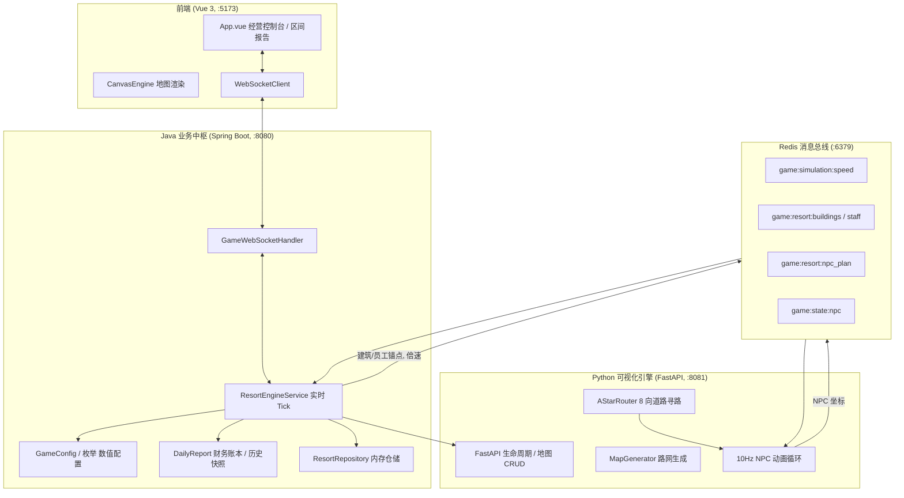

# 🏔️ 山间民宿度假村 · 挂机经营模拟系统 (Meileme Resort)

本系统是一款 **挂机经营沙盘**：开局后系统**连续实时仿真运行**（现实 **1 分钟 = 游戏 1 天**），
玩家**随时可操作**（建造 / 招人 / 定价 / 广告 / 团建接单），指令**次日 0 点生效**；
不再每日自动弹报告，改为玩家**自选时间区间（过去 1 天 / 7 天 / 30 天 / 1 年）按需生成经营报告**。

> 本工程由原「外卖调度模拟系统」整体改造而来：保留 Java 业务中枢 / 虚拟时间 tick / 财务账本 / WebSocket / Redis 总线 / Python 物理引擎 / A\* 寻路 / Vue3 地图渲染；彻底删除骑手、外卖订单、商家、派单等外卖业务。

---

## 📌 一、整体架构总览

系统采用 **「Java 业务中枢 + Python 可视化物理引擎 + Redis 消息总线 + Vue 3 实时前端」** 的协同架构。



**职责划分（重要）**

| 层 | 端口 | 职责 |
| :--- | :---: | :--- |
| Vue3 前端 | 5173 | 经营控制面板、区间报告、全局状态、Canvas 地图渲染 |
| Java 后端 | 8080 | **全部经营业务与数值计算**、逐日 tick、财务结算、WebSocket 网关 |
| Python 引擎 | 8081 | 地图生成、A\* 寻路、**游客/员工移动的纯可视化动画（10Hz）** |
| Redis | 6379 | Java ↔ Python 状态总线 |

> ⚠️ **游客、员工的 A\* 移动仅用于前端可视化，不参与任何核心业务数值计算；一切业务数值均由 Java 层计算。**

---

## 🕐 二、时间与季节模型

| 项 | 规则 |
| :--- | :--- |
| 虚拟时间基准 | `2026-07-01 00:00:00`（`GameConfig.BASE_VIRTUAL_TIME_MS`） |
| 时间流速 | 现实 **1 秒 = 游戏 24 分钟**（`VIRTUAL_MS_PER_REAL_SECOND = 1440000`） |
| 一天时长 | 现实 **1 分钟 = 游戏 1 天**（1 游戏日 = 24 游戏小时 = `GAME_DAY_VIRTUAL_MS`） |
| 全局倍速 | **0.5x / 1x / 2x / 4x / 8x / 16x**（`SET_SIMULATION_SPEED`，统一缩放虚拟时钟与 Python 物理步长 `dt = 0.1 × speed`；1x 一天 60 秒、4x 一天 15 秒、16x 一天 3.75 秒） |
| 季节轮换 | 每 **30 游戏天**切换；春 → 夏 → 秋 → 冬 → 循环 |
| 季节客流系数 | 春 `1.0` / 夏（旺季）`1.8` / 秋 `0.9` / 冬（淡季）`0.5` |
| 破产判定 | 每日结算后 **资金 ≤ 0** → 本局结束 |

**游戏日阶段状态机（`Resort.DayPhase`）**

```
开局
  └─ RUNNING           实时经营（现实 1 分钟 = 游戏 1 天 × 倍速，全程连续运行、玩家随时可操作）
        ├─ 玩家操作指令 → 进入「待生效指令队列」，次日 00:00 统一生效（建造费/解锁费点击即扣）
        ├─ 团建单当天有效：接受 → 次日生效结算；不操作 → 次日自动拒绝（无罚款）
        └─ 当日 24:00 → 结算 → 广播 DAY_SETTLED 轻提示 → 次日 00:00
  └─ GAME_OVER（资金 ≤ 0 破产，本局结束）
```

> **没有「决策窗口」**：仿真不再暂停，无需点「开始今日仿真」。暂停（`PAUSE_GAME`）只是可选兜底功能。

**看得见的时间（前端头部时钟）**

- 服务端每约 **1 秒**推进时钟，另由 `@Scheduled(fixedRate=200)` 的轻量广播循环每 **0.2 秒**推一条 `TIME_TICK`（仅时间字段，不含建筑/员工大数组）。
- 前端头部状态条显示：**🕘 当日游戏时刻（00:00 → 24:00）+ 当日进度条**（不再显示倒计时）。
- 两次推送之间前端按 `virtualMsPerRealSecond` 本地插值平滑走字，收到推送即校准；**暂停 / 切倍速会立刻重推**，刷新页面由连接快照恢复（不跳字）。
- 暂停时 `virtualMsPerRealSecond = 0`，时钟与进度条冻结。

---

## 🗺️ 三、地图与地块

- 地图为 **201 × 201** 逻辑网格（坐标 `-100 ~ +100`），启动时**随机生成一座度假村地形**或加载自制地图。
- **随机地形**：左上生成一座**山体**（内嵌不可建的**山峰**），右下生成一片**湖面**；山脚铺设园区主干道 + 小路网，并修一条**盘山公路**通到山腰、一条**湖畔道路**沿湖岸绕行。
- 瓦片类型（`map_generator.py`）：

| 瓦片 | 值 | 颜色 | 说明 |
| :--- | ---: | :---: | :--- |
| 主干道 | 1 | ⬜ `#ffffff` | 园区主干道（12.0 格/秒） |
| 大路 | 2 | 🔘 `#94a3b8` | 6.0 格/秒 |
| 小路/山路 | 3 | ⚫ `#475569` | 盘山路 / 湖畔路（3.0 格/秒） |
| 草地 | 8 | 🟩 `#31402a` | 平地 / 山脚底图 |
| 湖面 | 9 | 🟦 `#1e5b78` | 水域，不可建造 |
| 山体 | 10 | 🟫 `#7a5c34` | 山腰坡面，可建造 |
| 山峰 | 11 | ⬛ `#57506b` | 不可建造 |

> 瓦片 4~7（商住分区）仅为**地图编辑器**兼容而保留，随机生成器已不再使用。

- **地块（真实几何区域，由地形推导）**：`analyze_map()` 按「山体→山腰、湖岸→湖畔、其余平地→山脚」把地图划分为三块区域，并通过 `plots` 字段下发各区域的格子集合供前端渲染分区：

| 地块 | 区域来源 | 解锁成本 | 建筑数量上限 |
| :--- | :--- | ---: | ---: |
| 山脚 `INITIAL` | 距园区中心 46 格以内的平地 | 0（默认解锁） | 8 |
| 山腰 `MOUNTAIN` | 山体坡面 | 35000 | 12 |
| 湖畔 `LAKESIDE` | 距湖面 7 格以内的平地 | 60000 | 16 |

- **可建造格 `buildableCells`**：Python 输出 `[x, y, plotId]` 三元组——位于地块内、且与道路 8-邻域相邻的格子。**Java 只在所选地块（plotId）内的空位放置建筑**；游客/员工的 A\* 目的地锚点也落在这些临路格上。
- 开局 / 重新开局时，Java 会把最新地图以 `MAP_DATA` **广播给已连接的客户端**（修复此前换图不刷新）；建造成功后前端弹「建造成功」提示并**自动把镜头定位到新建筑**，顶部另有「🗺️ 整图」一键回到全貌。
- 地图编辑器（`MapEditor.vue`）与地图 CRUD REST API（`:8081/api/maps`）保留可用；改造前的旧城市存档已清除。

---

## ☕ 四、Java 业务中枢与逐日 Tick

代码位置：`backendjava/src/main/java/com/meileme/backend/`

| 类 / 方法 | 职责 |
| :--- | :--- |
| `ResortEngineService.startGame(mapId)` | 调 Python 取地图/可建造格 → **清空上一局残留的内存汇总历史** → 重置 `Resort` → 进入第 1 日 `beginDay()` |
| `ResortEngineService.scheduledLoop()` `@Scheduled(1s)` | 推进虚拟时钟（按倍速累加）；跨日触发 `endDay()` → 若未破产则 `beginDay()` |
| `tickBroadcastLoop()` `@Scheduled(200ms)` | 每 0.2 秒广播当日前游戏时钟 `TIME_TICK`（让玩家看见时间流逝） |
| `beginDay()` | 换季 → 修复自动停用（`AUTO`）建筑（手动停用 `MANUAL` 保持不变）→ 生成 0~2 笔团建单 → 广播 `DAY_STARTED` / `TEAM_ORDERS_OFFERED` / `RESORT_STATE` |
| `endDay()` | 结算 → 逐条广播 `EVENT_TRIGGER` + 换日轻提示 `DAY_SETTLED` → 破产判定 → `applyPendingCommands()` → `rejectStaleTeamOrders()` → 次日 |
| `computeDailyReport(day, dueTeamOrders)` | **全部经营数值计算**（需求、容量、收入、支出、口碑）；团建结算用传入的「当日到期团建单」 |
| `rollEvents(day)` | 按概率触发当日随机事件（自动执行；「本地旅游团到访」例外 → 生成次日可见待决团建单交玩家决定） |
| `applyPendingCommands()` | 次日 00:00 统一应用「待生效指令队列」（建造 / 招人 / 解雇 / 定价 / 广告 / 地块解锁 / 团建接单 / 建筑停用启用 / 拆除） |
| `rejectStaleTeamOrders()` | 清理隔天仍未处理的团建单 → 自动拒绝（无罚款） |
| `aggregateRange(rangeDays)` / `sendRangeReport()` | 按区间（1 / 7 / 30 / 365 天）聚合历史快照，生成区间报告**只回请求方** |
| `syncFromPython()` `@Scheduled(200ms)` | 读取 `game:state:npc` 并转发前端 `NPC_UPDATE` |
| `syncStateToSession()` | 新连接会话全量同步（`RESORT_STATE` 含 pendingCommands / scheduledOrders、`TIME_TICK`、团建单） |
| `buildBuilding` / `hireStaff` / `fireStaff` / `setRoomPrice` / `setAdBudget` / `unlockPlot` / `acceptTeamOrder` / `rejectTeamOrder` / `toggleBuildingDisable` / `demolishBuilding` | 经营操作（**入待生效队列，次日 0 点生效**；建造费 / 解锁费点击时立即扣除）。**建造为两段式**：点击后立即在所选地块放置一座「🚧 施工中」建筑（占格已预留，status=1），次日 0 点转正式运营（status=0）。**停用/启用**：`toggleBuildingDisable` 仅接受 `status=0`（转手动停用 `MANUAL`）或 `status=2 且 MANUAL`（转启用，扣启用经费 `REBUILD_RATIO`），其余状态返回 `ACTION_FAILED`。**拆除**：`demolishBuilding` 仅接受 `status=0`，次日返还残值 `DEMOLISH_RESIDUAL_RATIO` 并释放格子与地块上限 |

**服务端硬约束**：所有经营操作指令在 `guard(action)` 中校验 —
若当前 **无对局 / 已破产**（`resort == null || resort.isGameOver()`），一律返回
`ACTION_FAILED {action, reason:"GAME_NOT_RUNNING"}`。
运行期玩家**可随时操作**，操作**不立即生效**，而是进入「待生效指令队列」，在**次日 00:00** 统一应用。

### 每日结算公式（`computeDailyReport()`）

```
散客需求 = 60 × 季节系数 × 广告系数 × 口碑系数 × 前台系数 × 价格系数 × 当日事件系数
  广告系数 = 1 + min(0.80, 广告预算/1000 × 0.15)
  口碑系数 = max(0.30, 1 + (口碑 − 70) × 0.01)   ← 平滑衰减、保底 0.30，避免口碑死亡螺旋（已移除口碑 < 50 的 ×0.5 断崖腰斩）
  前台系数 = 有前台 ? 1.0 : 0.75
  价格系数 = clamp(1 − 1.5 × (混合价/400 − 1), 0.2, 1.8)   ← 提价客流降、降价客流升
    混合价 = 0.7 × 普通房价 + 0.3 × 豪华房价（0.3 与「30% 豪华偏好」一致）
    400   = 0.7 × 280 + 0.3 × 680（基准混合价，此时价格系数 = 1.0）
  事件系数 = (网红打卡 ? 1.6 : 1.0) × (回头客推荐 ? 1.2 : 1.0)

接待上限 = 可用客房容量 + 停车场 × 20
  过夜游客   = min(需求, 可用客房容量)
  日间游客   = min(需求 − 过夜游客, 停车场容量)
  超出部分   = 需求 − 过夜游客 − 日间游客   → 不接待、不扣口碑

房型分配：过夜游客中 30% 偏好豪华套房（不足则转普通客房）

当日总收入 = 散客房费收入 + 餐饮消费 + 游乐消费 + 团建订单收入
  散客房费 = 普通房占用数 × 普通房价 + 豪华房占用数 × 豪华房价
  餐饮消费 = min(在场游客, 餐厅容量) × 80   （需餐厅 + 厨师）
  游乐消费 = min(在场游客, 温泉容量+观景台容量) × 60 × (暴雨 ? 0.4 : 1.0)   （温泉需维修）
  团建收入 = Σ 满足条件的已接受团建单收益

当日总支出 = 员工日工资 + 建筑每日维护费 + 广告投入 + 事件维修费 + 团建违约罚款

当日净利润 = 当日总收入 − 当日总支出   （集体投诉事件再 × 0.85）
新资金     = 旧资金 + 当日净利润
口碑变化   = Σ 事件口碑影响 + 被动口碑加成 − 保洁不足惩罚 − 员工失误惩罚（钳制 0~100）
  被动口碑 = 高入住率(≥80%) ? +1 ｜ 四类岗位(前台/保洁/厨师/维修)齐备 ? +1 ｜ 当日无负向事件 ? +1   （单日上限 +3）
```

---

## 💰 五、经营数值配置（集中在 `GameConfig` 与枚举，禁止硬编码）

配置位置：`backendjava/src/main/java/com/meileme/backend/config/`
（`GameConfig.java`、`Season.java`、`BuildingType.java`、`StaffType.java`、`SalaryMode.java`、`TeamOrderSize.java`、`EventType.java`）

### 开局与散客

| 项 | 值 |
| :--- | ---: |
| 初始资金 | 20000 |
| 初始口碑 | 70（范围 0~100） |
| 基础客流 | 60 人/日 |
| 广告加成 | 每投入 1000 元 → 客流 +15%，上限 +80% |
| 口碑客流影响 | 每 ±1 点 → 客流 ±1%；口碑系数 = max(0.30, 1 + (口碑 − 70) × 0.01)，下限 0.30 平滑保底 |
| 房价基准 | 普通 280 / 豪华 680（基准混合价 400） |
| 房价需求弹性 | E = 1.5；价格系数钳制 [0.2, 1.8]（提价客流降、降价客流升） |
| 单客餐饮消费 | ¥80 |
| 单客游乐消费 | ¥60 |
| 缺前台入住率惩罚 | −25% |

### 建筑配置

| 建筑类型 | 建造成本 | 每日维护 | 容纳人数 | 备注 |
| :--- | ---: | ---: | ---: | :--- |
| 普通客房 `STANDARD_ROOM` | 3000 | 120 | 2 人/间 | 基础住宿，默认房价 280/晚 |
| 豪华套房 `LUXURY_SUITE` | 8000 | 350 | 4 人/间 | 高客单价，默认房价 680/晚 |
| 餐厅 `RESTAURANT` | 6000 | 220 | 8 人 | 必须有厨师才能产生餐饮收入 |
| 温泉池 `SPA` | 7500 | 280 | 6 人 | 游乐设施，需维修人员维护 |
| 观景台 `VIEWPOINT` | 4000 | 150 | 10 人 | 游乐设施 |
| 停车场 `PARKING` | 2500 | 80 | +20 总接待上限 | 无直接收益，降低游客流失 |

> **建造两段式与建筑状态**（`Building.status`）：`0` 正式运营可用 · `1` 施工中 · `2` 临时停用。
> `status=2` 细分停用来源 `Building.disableSource`：`AUTO`（系统自动·水管爆裂）与 `MANUAL`（玩家手动）。
> 点击「建造」后立即扣费，并在地图上生成一座半透明 `🚧 施工中` 幽灵建筑（占格即刻预留、计入地块建筑数上限），
> **施工中不产生客房容量 / 收入，也不计每日维护费，且不作为 NPC 寻路锚点**；次日 0 点转为 `0` 可用后全部生效。

### 建筑停用 / 启用 / 拆除

| 操作 | 允许的前置状态 | 次日 0 点生效结果 | 费用 |
| :--- | :--- | :--- | :--- |
| 手动停用（`MANUAL`） | `status=0` 正式运营 | `status=2` + `disableSource=MANUAL`；**不再产生容量 / 收入，且不再扣每日维护费**；仍占用地块格子与地块建筑数上限，但**不再作为 NPC 寻路锚点** | 免费 |
| 手动启用 | `status=2` 且 `MANUAL` | 恢复 `status=0` 并清空 `disableSource`，重新产生容量 / 收入与每日维护费 | **启用经费 = 建造成本 × `REBUILD_RATIO`（0.3）**，次日生效时才扣；资金不足则跳过并记日志 |
| 拆除 | `status=0` 正式运营 | 从建筑列表移除，释放占用地块格子与地块建筑数上限，不再计维护费 | **返还残值 = 建造成本 × `DEMOLISH_RESIDUAL_RATIO`（0.3）** |

> **水管爆裂自动停用（`AUTO`）保持旧逻辑不变**：仅当日临时失效、**仍照扣每日维护费**、次日 0 点自动恢复 `status=0`；系统自动停用期间玩家**无法手动启用**。
> `status=1` 施工中**不允许手动停用、不允许拆除**；`status=2`（无论 `AUTO` / `MANUAL`）**禁止拆除**。
> 玩家操作全部进入「待生效指令队列」，**次日 0 点生效时二次校验**（建筑仍在、状态未变、启用经费足额），否则跳过并写日志；
> 同一建筑同一时刻仅允许一条「停用 / 启用 / 拆除」指令，互斥防冲突。

### 员工配置

| 岗位 | 每日底薪 | 工作效率 | 负面事件概率 | 说明 |
| :--- | ---: | ---: | ---: | :--- |
| 前台 `FRONT_DESK` | 180 | 100% | 5% | 缺少前台，入住率 −25% |
| 保洁 `CLEANING` | 160 | 100% | 8% | 保洁不足造成口碑下降 |
| 厨师 `CHEF` | 220 | 100% | 6% | 餐厅必备 |
| 维修 `MAINTENANCE` | 200 | 100% | 3% | 维护温泉、观景台 |

**薪资档位倍率（`SalaryMode`）**

| 档位 | 薪资 | 效率 | 负面事件概率 |
| :--- | ---: | ---: | ---: |
| 高薪 `HIGH` | +30% | 120% | 减半 |
| 标准 `NORMAL` | 基准 | 100% | 基准 |
| 廉价 `LOW` | −30% | 80% | 翻倍 |

**员工负面事件后果**（每日按概率独立判定，同类事件当日只结算一次）

| 岗位失误 | 后果 |
| :--- | :--- |
| 前台 | 当日入住率 −10% |
| 保洁 | 当日口碑 −2 |
| 厨师 | 当日餐饮收入 −30% |
| 维修 | 当日设施故障维修 ¥500 |

**保洁配置**：每 10 间客房需 1 名保洁（按效率倍率折算）；不足则当日口碑 −2。

### 团建大单配置（每日随机 0~2 单，游戏日开始推送；当天有效，可随时接受 / 拒绝）

| 规模 | 需要客房数 | 总收益 | 违约罚款 | 必备配套 |
| :--- | ---: | ---: | ---: | :--- |
| 小型 `SMALL` | 6 | 18000 | 6000 | 餐厅 |
| 中型 `MEDIUM` | 12 | 40000 | 13000 | 餐厅 + 温泉 |
| 大型 `LARGE` | 20 | 75000 | 25000 | 餐厅 + 温泉 + 观景台 |

- 接受 → 该单进入「已接单 · 待生效」，**次日生效结算**；次日客房 / 配套不满足 → 该单违约，扣除对应罚款（违约**原因**会写入本局日志的「团建结算」明细）。
- 客房按「大单优先」占用；团建单优先占用普通客房。
- 次日 0 点仍未处理的团建单 → **自动拒绝（无罚款）**。

### 随机事件（每个游戏日按概率触发，自动执行，玩家无法干预）

| 事件 | 触发概率 | 效果 |
| :--- | ---: | :--- |
| **负向** 暴雨 | 10% | 温泉、观景台当日收益 −60%，口碑 −3 |
| **负向** 水管爆裂 | 2% | 维修成本 1200；3 间客房当日不可用；口碑 −4 |
| **负向** 游客集体投诉 | 3% | 口碑 −6，当日净利润 −15% |
| **负向** 设施小故障 | 5% | 维修成本 500，无口碑惩罚 |
| **正向** 网红打卡 | 10% | 当日散客客流 ×1.6，口碑 +8 |
| **正向** 好评如潮 | 6% | 口碑 +8 |
| **正向** 回头客推荐 | 5% | 当日散客客流 ×1.2，口碑 +5 |
| 本地旅游团到访 | 5% | 次日新增 1 笔**可见**小型团建订单（进入「今日团建订单」区，由玩家自行接/拒；不接则次日自动拒绝、无罚款） |
| 口碑自然提升（被动） | 每日判定 | 见上文「被动口碑」：高入住率 / 四岗齐备 / 无负向事件各 +1，单日上限 +3 |
| 团建履约奖励 | 每日判定 | 当日**所有已生效团建单全部履约成功**（至少 1 单）→ 口碑 +`TEAM_SUCCESS_REPUTATION_BONUS`（3） |

> 说明：为平衡「口碑提升手段过少、下降事件过多」的问题，新增 2 个正向随机事件（好评如潮 / 回头客推荐）+ 每日**被动口碑**加成，
> 并下调负向事件的口碑惩罚（暴雨 −5→−3、水管爆裂 −8→−4、投诉 −12→−6、保洁失误 −3→−2）、提高网红打卡效果与概率（好评 +6→+8、概率 7%→10%）。
> 硬性现金扣减项（水管爆裂 / 小故障 / 维修失误）此前已下调（2500→1200、800→500、800→500）。数值统一在 `GameConfig`，事件文案由配置动态拼装（不硬编码）。

---

## 🚶 六、Python 可视化引擎

代码位置：`backendpython/`

| 文件 | 说明 |
| :--- | :--- |
| `pathfinding.py` | **通用底层，保持不动**。8 方向 A\*、Octile 启发式、拐点压缩、道路速度表 |
| `map_generator.py` | 度假村地形生成（山 / 湖 / 山路）+ `analyze_map()` 推导地块分区与带 `plotId` 的 `buildableCells` |
| `engine.py` | `ResortEngine`：10Hz 动画循环 |
| `main.py` | FastAPI 生命周期（start/pause/resume/stop）与地图 CRUD |
| `map_storage.py` | 地图持久化（`saved_maps/{map_id}.json`） |

**`ResortEngine` 行为（纯可视化）**

- 每 tick 从 Redis 读取建筑锚点 `game:resort:buildings` 与员工锚点 `game:resort:staff` 作为目的地候选。
- 按 `game:resort:npc_plan` 对齐 NPC 数量（**全量渲染：有多少游客就渲染多少，不设上限**），不足则从园区入口（距 (0,0) 最近道路格）附近补齐。对齐周期随倍速缩放（`max(1.0s / speed, 0.2s)`），高倍速下更频繁补齐/裁剪。
- 物理步长 `dt = 0.1 × speed`，并**按 0.1s 拆分子步**逐段推进，避免高倍速下单步过大导致 NPC 瞬移。
- 每个 NPC：A\* 寻路 → 沿路点匀速前进 → 到达后驻留 **2~4 秒** → 换下一个目标。
- 员工优先在与其岗位相关的建筑附近往返（前台/保洁↔客房，厨师↔餐厅，维修↔温泉/观景台/停车场）。
- 输出 NPC 坐标到 Redis `game:state:npc`，**不产生任何业务事件、不读写任何业务键**。
- 可配置常量集中在 `engine.py` 顶部（`TICK_INTERVAL`、`NPC_DWELL_MIN/MAX`、`POOL_ALIGN_INTERVAL`、`ENTRANCE_SEARCH_RADIUS`、`STAFF_BUILDING_PREFERENCE`）。

---

## 🔌 七、WebSocket 协议（`ws://localhost:8080/game`）

### 客户端 → 服务端（`{ "command": "...", ... }`）

| 指令 | 参数 | 说明 |
| :--- | :--- | :--- |
| `START_GAME` | `mapId?` | 开新局 |
| `STOP_GAME` | — | 结束并重置 |
| `PAUSE_GAME` / `RESUME_GAME` | — | 暂停 / 继续（可选兜底） |
| `SET_SIMULATION_SPEED` | `speed` | 0.5 / 1 / 2 / 4 / 8 / 16 |
| `REQUEST_RANGE_REPORT` | `rangeDays` | 请求区间报告，取值 1 / 7 / 30 / 365 |
| `REQUEST_DAILY_LOG` | — | 请求本局完整每日结算日志（近 365 天，**只回请求方**） |
| `BUILD_BUILDING` | `buildingType`, `plotId` | 建造建筑（点击即扣费并立即显示 🚧 施工中，次日 0 点生效） |
| `HIRE_STAFF` | `staffType`, `salaryMode` (normal/high/low) | 招聘员工 |
| `FIRE_STAFF` | `staffId` | 解雇员工 |
| `SET_ROOM_PRICE` | `standardRoomPrice`, `luxuryRoomPrice` | 设置房价 |
| `SET_AD_BUDGET` | `adBudget` | 设置广告预算 |
| `ACCEPT_TEAM_ORDER` / `REJECT_TEAM_ORDER` | `orderId` | 团建单接受 / 拒绝 |
| `UNLOCK_PLOT` | `plotId` (MOUNTAIN/LAKESIDE) | 地块解锁（次日生效，费用即扣） |
| `TOGGLE_BUILDING_DISABLE` | `buildingId` | 停用 / 启用建筑（`status=0`→手动停用；`status=2 且 MANUAL`→启用并扣启用经费；其余状态 `ACTION_FAILED`） |
| `DEMOLISH_BUILDING` | `buildingId` | 拆除建筑（仅 `status=0`；次日返还残值并释放格子与地块上限） |
| `GET_MAP` / `CHECK_STATUS` | — | 拉取地图 / 状态 |

### 服务端 → 客户端（`{ "type": "...", "data": ... }`）

| 消息 | 载荷 |
| :--- | :--- |
| `MAP_DATA` | 地图 / 地形瓦片 / `plots` 分区 / `buildableCells`（`[x,y,plotId]`）；开局/重新开局时主动广播 |
| `GAME_STARTED` / `GAME_STOPPED` | 局开始 / 结束；`GAME_STOPPED` 额外携带 `{daysSurvived, finalCash, dailyReports}`（本局全部每日结算日志，供结束弹窗展示） |
| `RESORT_STATE` | 全量经营状态（资金/口碑/季节/日/阶段/建筑/员工/定价/广告/地块 + `pendingCommands` 待生效指令 + `scheduledOrders` 待生效团建单） |
| `DAY_STARTED` | `{day, season, seasonName}` |
| `TEAM_ORDERS_OFFERED` | `GuestOrder[]`（今日待决团建单） |
| `SIMULATION_SPEED_CHANGED` | 顶层 `speed` |
| `SIMULATION_PAUSED` / `SIMULATION_RESUMED` | 暂停 / 继续 |
| `EVENT_TRIGGER` | 单个 `GameEvent`（结算日逐条广播） |
| `DAY_SETTLED` | `{day, netProfit, cash, reputation}`（换日轻提示，替代原 `DAILY_REPORT`） |
| `RANGE_REPORT` | 区间经营报告（见下，**只回请求方**） |
| `DAILY_LOG` | `DailyReport[]` 精简版（逐日 `day/seasonName/netProfit/cashAfter/totalRevenue/totalExpense/occupancyRate/reputation*/revenueDetail/expenseDetail/events/teamOrders`，**只回请求方**） |
| `NPC_UPDATE` | `{guests:[...], staff:[...]}`（约 5Hz 可视化坐标） |
| `TIME_TICK` | `{day, phase, virtualTimeMs, gameDayVirtualMs, virtualMsPerRealSecond, speed, paused}`（约 5Hz 当日时钟，让玩家看见时间流逝；新连接快照也会带上） |
| `BANKRUPTCY` | `{daysSurvived, finalCash, endReason, lastDay, lastCashBefore, lastNetProfit, lastTotalRevenue, lastTotalExpense, revenueDetail, expenseDetail, dailyReports}`（含末日收支明细 + **本局全部每日结算日志**，供玩家复盘） |
| `ACTION_FAILED` | `{action, reason}` |

### JSON 样例

```json
{ "command": "START_GAME", "mapId": "my_resort_01" }
```
```json
{ "command": "BUILD_BUILDING", "buildingType": "LUXURY_SUITE", "plotId": "INITIAL" }
```
```json
{ "command": "HIRE_STAFF", "staffType": "CHEF", "salaryMode": "high" }
```
```json
{ "command": "SET_AD_BUDGET", "adBudget": 3000 }
```
```json
{ "command": "ACCEPT_TEAM_ORDER", "orderId": "team-3f9a1c2b" }
```
```json
{ "command": "REQUEST_RANGE_REPORT", "rangeDays": 7 }
```

```json
{
  "type": "RESORT_STATE",
  "data": {
    "cash": 20000, "reputation": 70, "season": "SPRING", "seasonName": "春季",
    "day": 1, "phase": "RUNNING",
    "standardRoomPrice": 280, "luxuryRoomPrice": 680, "adBudget": 0,
    "unlockedPlots": ["INITIAL"],
    "buildings": [
      { "id": "b-1a2b3c4d", "type": "STANDARD_ROOM", "typeName": "普通客房",
        "plotId": "INITIAL", "position": { "x": 12, "y": -7 }, "status": 0 }
    ],
    "staffList": [
      { "id": "s-5e6f7a8b", "type": "FRONT_DESK", "typeName": "前台", "salaryMode": "NORMAL",
        "dailySalary": 180, "efficiencyMultiplier": 1.0, "negativeEventProb": 0.05 }
    ],
    "teamOrders": [
      { "id": "team-3f9a1c2b", "orderType": "TEAM", "size": "MEDIUM", "sizeName": "中型团建",
        "requiredRooms": 12, "guestCount": 24, "revenue": 40000, "penalty": 13000,
        "status": "PENDING", "createdDay": 1, "effectiveDay": 0 }
    ],
    "pendingCommands": [
      { "id": "pc-7d8e9f", "type": "BUILD_BUILDING", "summary": "建造 豪华套房 @ 初始地块",
        "queuedDay": 1, "text1": "LUXURY_SUITE", "text2": "INITIAL", "num1": 0, "num2": 0 }
    ],
    "scheduledOrders": [
      { "id": "team-1a2b3c4d", "orderType": "TEAM", "size": "SMALL", "sizeName": "小型团建",
        "requiredRooms": 6, "guestCount": 12, "revenue": 18000, "penalty": 6000,
        "status": "ACCEPTED", "createdDay": 1, "effectiveDay": 2 }
    ]
  }
}
```

```json
{
  "type": "TIME_TICK",
  "data": {
    "day": 3, "phase": "RUNNING",
    "virtualTimeMs": 1783008000000, "gameDayVirtualMs": 86400000,
    "virtualMsPerRealSecond": 1440000,
    "speed": 1.0, "paused": false
  }
}
```
```json
{
  "type": "TEAM_ORDERS_OFFERED",
  "data": [
    { "id": "team-3f9a1c2b", "orderType": "TEAM", "size": "MEDIUM", "sizeName": "中型团建",
      "requiredRooms": 12, "guestCount": 24, "revenue": 40000, "penalty": 13000,
      "requiresRestaurant": true, "requiresSpa": true, "requiresViewpoint": false,
      "status": "PENDING", "createdDay": 1 }
  ]
}
```

```json
{
  "type": "DAY_SETTLED",
  "data": { "day": 1, "netProfit": 480, "cash": 20480, "reputation": 68 }
}
```

```json
{
  "type": "RANGE_REPORT",
  "data": {
    "rangeDays": 7, "fromDay": 1, "toDay": 7, "dayCount": 7,
    "cashStart": 20000, "cashEnd": 23480, "netProfit": 3480,
    "totalRevenue": 31920, "totalExpense": 28440,
    "revenueDetail": { "roomFee": 19600, "dining": 8960, "recreation": 3360, "teamOrder": 0 },
    "expenseDetail": { "staffSalary": 3780, "buildingMaintenance": 2380, "adBudget": 0, "eventCost": 5600, "teamPenalty": 0 },
    "avgOccupancyRate": 58.2, "totalGuestsServed": 126, "totalTurnedAway": 84,
    "reputationStart": 70, "reputationEnd": 64, "reputationDelta": -6,
    "eventCounts": { "设施小故障": 3, "暴雨": 1, "游客投诉": 1 },
    "teamOrdersAccepted": 2, "teamOrdersDefaulted": 1,
    "teamOrderRevenue": 18000, "teamPenalty": 6000,
    "dailySeries": [
      { "day": 1, "seasonName": "春季", "netProfit": 480, "revenue": 4560, "expense": 4080,
        "occupancyRate": 62.5, "guestsServed": 18, "cashAfter": 20480, "reputationAfter": 68 }
    ],
    "bestDay": { "day": 4, "netProfit": 1920 }, "worstDay": { "day": 6, "netProfit": -640 }
  }
}
```

```json
{ "type": "ACTION_FAILED", "data": { "action": "BUILD_BUILDING", "reason": "GAME_NOT_RUNNING" } }
```
```json
{ "type": "BANKRUPTCY", "data": {
    "daysSurvived": 14, "finalCash": -1200, "endReason": "资金 ≤ 0，资不抵债",
    "lastDay": 14, "lastCashBefore": 2000, "lastNetProfit": -3200,
    "lastTotalRevenue": 2400, "lastTotalExpense": 5600,
    "revenueDetail": { "roomFee": 1600, "dining": 640, "recreation": 160, "teamOrder": 0 },
    "expenseDetail": { "staffSalary": 540, "buildingMaintenance": 760, "adBudget": 0, "eventCost": 4300, "teamPenalty": 0 }
} }
```

---

## 🔴 八、Redis 状态总线

| 键 | 方向 | 类型 | 说明 |
| :--- | :--- | :--- | :--- |
| `game:simulation:speed` | Java → Python | String | 全局倍速（Python 每 tick 读取，`dt = 0.1 × speed`） |
| `game:resort:buildings` | Java → Python | Hash | `buildingId → {"type","x","y"}` 建筑可视化锚点 |
| `game:resort:staff` | Java → Python | Hash | `staffId → {"type","x","y"}` 员工岗位锚点 |
| `game:resort:npc_plan` | Java → Python | String | `{"guests":N,"staff":M}` NPC 全量渲染目标数 |
| `game:state:npc` | Python → Java | String | `{"guests":[{"id","x","y","status"}],"staff":[{"id","type","x","y"}]}` |

> 外卖时代的 `game:state:riders`、`game:rider:targets/status/orders/manual_targets`、`game:dispatch:mode`、`game:events:reach_target` **已全部删除**。

---

## 🖥️ 九、前端面板（Vue 3）

- **顶部全局状态条**：`📅 第 N 天` · 季节 · `🕘 当日游戏时刻（HH:MM）` · `💰 资金` · `⭐ 口碑` · 阶段（实时经营中）；下方为**当日进度条**（00:00 → 24:00，随 `TIME_TICK` 平滑推进，暂停时冻结）；右侧为**📊 生成报告**、**📜 完整日志**、暂停/继续、倍速分段按钮（0.5/1/2/4/8/16x）、整图、结束并重置。
- **经营控制面板**（开局后**全程可操作**，面板顶部显示「可操作 / 已锁定」标签）：
  - 建造：6 种建筑卡片，显示造价/维护/容量，点选建造（**费用即扣，次日 0 点生效**）。
  - **🏘️ 已建造建筑**：逐座列出当前度假村建筑（`图标 + 建筑名 · 所在地块 · 容量 · 维护费` + **状态标签**「运营中 / 施工中 / 已停用 / 临时停用」），便于直观核对规模与开销；每行带 **【停用】/【启用】/【拆除】** 按钮（**点击即一键入「待生效队列」，无二次确认**，随后按钮显示「⏳ 已排队」）——停用行显示「免维护」、启用按钮标注启用经费、施工中与临时停用建筑无可用按钮。
  - 员工管理：按岗位招聘（薪资档位 normal/high/low）、员工列表解雇。
  - 定价与广告：普通房价 / 豪华房价 / 广告预算。
  - 地块解锁：山地 ¥35000 / 湖畔 ¥60000。
  - 团建订单：**今日团建订单**（当天有效，【接受】/【拒绝】）+ **已接单 · 待生效**（显示第 N 天生效）。
  - **⏳ 进行中 · 次日 0 点生效**：按类别列出排队中的操作——🏗️ 施工中（建造，每条显示 `图标 + 建筑名 · 地块`，标「次日完工」）、👷 入职中（招聘）、🗺️ 开垦中（地块解锁）、📋 其它排队（定价 / 广告 / 解雇 / 团建 / **建筑停用启用 / 拆除**）。点击「建造」后地图上**立即**出现半透明 `🚧 施工中` 幽灵建筑，并自动把镜头定位过去。
- **区间经营报告弹窗**（`RangeReport.vue`）：点「📊 生成报告」按区间（过去 1 天 / 7 天 / 30 天 / 1 年）聚合展示——区间净利/资金变化、收支构成、平均入住率、接待与溢出、口碑变化、事件统计、逐日净利迷你走势、最佳/最差日。
- **地图区**：地块 / 建筑 / 游客 / 员工渲染（游客、员工全量绘制）；地图编辑器入口保留。
- **📜 完整日志弹窗**：点工具栏「📜 完整日志」向后端请求本局**近 365 天**的逐日结算详情（`DAILY_LOG`），逐日展示净利 / 资金 / 口碑变化 / **入住率 · 接待人数 · 溢出未接待** / 收入与支出拆解 / 团建结算 / 触发事件；手动「结束并重置」时也会随 `GAME_STOPPED` 自动弹出。
- **破产弹窗**：存活天数 / 最终资金 / 原因 + **末日收支明细**（收入：客房 / 餐饮 / 游乐 / 团建；支出：工资 / 维护 / 广告 / 事件 / 团建罚款；当日起始资金与净利）+ **本局全部每日结算日志（内嵌、可滚动、最多近 365 天）** + 【重新开局】。
- **每日日志的两层存储**（务请注意）：
  - **后端内存**（`ResortRepository.history`，`CopyOnWriteArrayList<DailyReport>`，上限 365 条）：是网页端「📜 完整日志」「破产内嵌日志」「区间报告」的唯一数据源。**纯内存态**：后端进程重启即丢失；「⏹️ 结束并重置」或**点「开始经营 / 重新开局」时**均会清空，保证每局内存日志互不串场。
  - **磁盘文件**：每局在 Java 工作目录 `logs/` 下新建一份 `game-<时间戳>.log`，逐日记录「日结各收入/支出拆解 + 触发事件 + **团建单明细**」与破产/结束行；控制台会打印日志的绝对路径。**永久保留在硬盘**，是跨重启复盘唯一可靠来源。
  - 两者互为补充：落盘偏完整长文本，网页弹窗偏结构化逐日结算速览；均覆盖**近 365 天**。
  - **团建单明细**（便于定位罚款来源）：`团建报价`（每张单生成日 / 规模 / 需房数 / 收益 / 违约罚款 / 必备配套）、`团建接受`（第 N 天接受、第 M 天生效）、`团建结算`（生效日履约 `+¥` 或违约 `-¥`，违约附带**原因**：缺餐厅/温泉池/观景台，或客房不足）。

前端回调（`WebSocketClient.js`）：
`onMapData` `onResortState` `onDayStarted` `onTeamOrders` `onDaySettled` `onRangeReport` `onDailyLog` `onEventTrigger` `onNpcUpdate` `onTimeTick` `onActionFailed` `onGameStarted` `onGameStopped` `onSpeedChanged` `onSimulationPaused` `onSimulationResumed` `onBankruptcy` `onStatusChange`。

---

## 📁 十、工程结构

```
meileme/
├── backendjava/                       # Java 业务中枢 (:8080)
│   └── src/main/java/com/meileme/backend/
│       ├── BackendApplication.java
│       ├── config/                    # 数值配置（唯一来源）
│       │   ├── GameConfig.java
│       │   ├── Season.java  BuildingType.java  StaffType.java
│       │   └── SalaryMode.java  TeamOrderSize.java  EventType.java
│       ├── model/                     # 内存实体
│       │   ├── Resort.java  Building.java  Staff.java
│       │   ├── GuestOrder.java  GameEvent.java  DailyReport.java  Coordinate.java
│       │   └── PendingCommand.java  RangeReport.java
│       ├── repository/ResortRepository.java
│       ├── service/ResortEngineService.java      # 实时 Tick 业务核心
│       ├── websocket/GameWebSocketHandler.java  # WS 网关
│       └── logs/                      # 每局日志落盘 game-<时间戳>.log（结束后仍可复盘）
├── backendpython/                     # Python 可视化引擎 (:8081)
│   ├── main.py  engine.py  pathfinding.py  map_generator.py  map_storage.py
│   └── saved_maps/                    # 自制地图持久化
└── frontendweb/                       # Vue 3 前端 (:5173)
    └── src/{App.vue, services/WebSocketClient.js,
              utils/CanvasEngine.js, components/{MapRenderer.vue, MapEditor.vue, RangeReport.vue}}
```

---

## 🚀 十一、快速启动

```bash
# 1) Redis
redis-server

# 2) Python 可视化引擎 (:8081)
cd backendpython && python3 -m uvicorn main:app --port 8081

# 3) Java 业务中枢 (:8080)
cd backendjava && mvn spring-boot:run

# 4) 前端 (:5173)
cd frontendweb && npm install && npm run dev
```

打开 `http://localhost:5173` → 选择/随机地图 → 【开始经营】→ **仿真立即连续运行**（现实 1 分钟 = 游戏 1 天，可调 0.5~16x 倍速加速）→
随时配置建造 / 招人 / 定价 / 广告（**次日 0 点生效**）、处理今日团建单（接受次日生效）→
点【📊 生成报告】按区间（过去 1 天 / 7 天 / 30 天 / 1 年）查看经营复盘。

---

> 本文档与代码保持同步迭代：任何数值、协议、Redis 键或面板改动，都会同步更新本 README。
