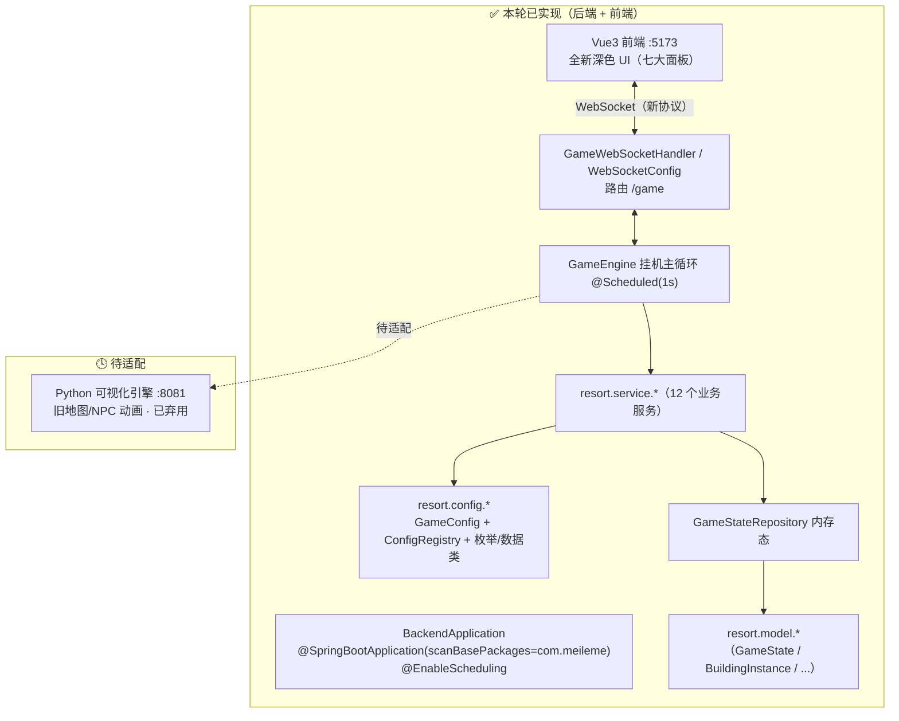

# 🏔️ 山间民宿度假村 · 挂机经营模拟系统（Meileme Resort）

纯**挂机经营**沙盘：开局后引擎连续实时仿真（现实 **1 分钟 = 游戏 1 天**，可 0.5~16x 倍速），
玩家随时下单。操作分两类生效方式：
**① 即时类操作**（招聘 / 培训 / 解雇 / 技能解锁 / 地块解锁）进入「待生效指令队列」，**次日 0 点**生效并二次校验；
**② 工程类操作**（建造 / 形态升级 / 分支进化 / 合并进化 / 内装升级）点击即**立即扣费**并进入「进行中」状态，
按各自**工期（游戏日，自次日起累计）**逐日推进，**达到工期后于当日 0 点生效**；施工期间建筑仍按**开工前**的状态正常经营。
本局为**无数值决策的挂机经营**——无定价权、无随机事件、无四季、无团建、无广告；
玩家做的是**建设 / 进化 / 内装 / 雇佣 / 技能**这一条长期成长线。

> **历史沿革（简述）**：本工程最初是「外卖调度模拟系统」（骑手 / 订单 / 派单 + Vue 地图 + Python 寻路可视化）；
> 其后整体改造为一版「度假村机制」（口碑 / 四季 / 随机事件 / 定价 / 团建 / 建筑停用拆除 / 旧 `BuildingType+StaffType`）；
> **本轮又彻底推翻该度假村机制，重做为全新玩法**：删除旧 `com.meileme.backend.*`（仅保留 `BackendApplication`），
> 新领域全部落在 `com.meileme.resort.*`。旧玩法（口碑、季节、事件、定价、团建、停用/拆除）均已移除。

> ⚠️ **本轮已完成后端玩法 + Vue3 前端全新深色 UI**（总览 / 区块 / 建筑 / 员工 / 技能 / 成就 / 日志 七大面板，全部基于新协议联调）。
> **Python 可视化引擎尚未适配新玩法**（旧地图 / A\* 寻路 / NPC 动画已弃用，本期无地形），属**待适配**状态。
> 当前可通过 `frontendweb`（Vue3 深色 UI）+ WebSocket 直连后端完整调试全部新玩法。
>
> ⚠️ **所有数值均为合理占位默认值**，处于「数值后期配置」阶段；**后续调参只改配置类**（`GameConfig` / `ConfigRegistry` / 各枚举），
> **业务代码内不硬编码任何数值**。

---

## 📌 一、整体架构总览

新后端为**单机单局内存态**：静态配置走 Java 配置类，运行时状态走内存仓储，逐日日志走内存环形队列。



| 层 | 端口 | 状态 | 职责 |
| :--- | :---: | :---: | :--- |
| Java 后端 | 8080 | ✅ 已实现 | **全部玩法与数值计算**、逐日 tick、财务结算、WebSocket 网关 |
| Vue3 前端 | 5173 | ✅ 已实现 | 全新深色 UI（总览 / 区块 / 建筑 / 员工 / 技能 / 成就 / 日志 七大面板），基于新协议 |
| Python 引擎 | 8081 | 🕓 待适配 | 旧地图生成 / A\* 寻路 / NPC 动画（本期无地形，已弃用） |
| Redis | 6379 | ❌ 不使用 | 新后端**不使用** Redis（`pom` 依赖仍在但业务代码零引用） |

**为什么本期不引入数据库**

- 单机单局、**无账号 / 无排行榜 / 无多人**需求 → 关系库与快照存储无收益；
- 静态配置（形态 / 配方 / 地块 / 成就 / 技能 / 区域客流）**全部落在 Java 配置类**，天然版本可控；
- 运行时状态走内存仓储、逐日日志走**内存环形队列（≤365 天）**，重启即失，符合「挂机单局」定位；
- 一旦出现**多玩家 / 审计回溯 / 排行榜**诉求，再引入 MySQL/PostgreSQL（持久化）或 Redis 快照（热状态）。

---

## 🕐 二、时间模型

| 项 | 规则 |
| :--- | :--- |
| 时间基准 | 现实 **1 分钟 = 游戏 1 天**（`REAL_SECONDS_PER_GAME_DAY = 60`） |
| 引擎 Tick | `TICK_INTERVAL_MS = 1000`（`@Scheduled(fixedRate=1000)` 推进时钟） |
| 时钟广播 | `@Scheduled(fixedRate=200)` 每 **200ms** 广播 `TIME_TICK`（**仅时间 / 进度 / 资金**，不含建筑员工大数组） |
| 倍速 | **0.5 / 1 / 2 / 4 / 8 / 16x**（`SPEED_OPTIONS`；默认 `1.0`） |
| 起始日 | `2026-07-01`（`DEFAULT_START_DATE`，**纯展示字段，不挂业务语义**） |
| 日志上限 | `REPORT_HISTORY_LIMIT = 365`（内存环形，超出裁剪最旧一条） |
| 对局结束 | 日常运营无固定支出，**不存在破产**；仅玩家主动 `STOP_GAME` 才结束对局 |

> **无随机事件、无四季系统**。时间只提供「日 + 日期展示 + 当日进度」，不携带任何季节 / 天气 / 事件语义。
> **局内进度重开全部清空**：新局直接重建 `GameState`，不残留上一局任何日志 / 实体。
> **建筑不可拆除、不可手动停用**（新玩法无此机制）。

---

## 🏗️ 三、建筑体系

### 3.1 母本与第一期可建范围

**住宿母本 6 种** + **配套母本 9 种**；**第一期开放「标准客房」（住宿）+「餐厅 / 温泉泡池 / 观景台」（配套）可建造**
（`MotherBuildingType.isPhase1Buildable()`），其余母本**仅登记、不可建**（是否可建还受地块白名单二次约束）。

| 母本 | 类别 | 第一期可建 |
| :--- | :---: | :---: |
| `STANDARD_ROOM` 标准客房 | 住宿 | ✅ |
| `RESTAURANT` 餐厅 · `HOT_SPRING_POOL` 温泉泡池 · `VIEWING_PLATFORM` 观景台 | 配套 | ✅ |
| `LUXURY_ROOM` 豪华客房 · `WOODEN_CABIN` 独栋木屋 · `DUPLEX_LOFT` 复式LOFT · `COURTYARD_HOUSE` 庭院小院 · `MULTI_BEDROOM_HOUSE` 多卧平房 | 住宿 | ❌ 仅登记 |
| `RECEPTION_LOBBY` 接待大堂 · `TEA_LIBRARY` 茶室书吧 · `CULTURE_WORKSHOP` 文创工坊 · `LOGISTICS_WAREHOUSE` 后勤库房 · `OUTDOOR_CAMP` 户外营地 · `PARENT_CHILD_PARK` 亲子乐园 | 配套 | ❌ 仅登记 |

### 3.2 形态（BuildingForm）

- 每个形态自带等级 **Lv1~Lv3**（`FORM_MIN_LEVEL`/`FORM_MAX_LEVEL`）；**形态满级（Lv3）后才可进行下一阶段分支进化**。
- 形态固有属性：**客群影响系数**（`affinity`，形态固有；内装会在此之上额外叠加客群吸引力加成）、每间可接待人数、每间固定房屋收益、
  基础舒适度、能力需求、各等级内装上限。
- 等级加成：分配权重 `1 + 0.20 × (level − 1)`；基础舒适度 `baseComfort × (1 + 0.15 × (level − 1))`。

**已配置形态（`ConfigRegistry`）**

| 形态 ID | 名称 | 进化线 | tier | 每间人数 | 房屋收益 Lv1/2/3 | 基础舒适 | 内装上限 |
| :--- | :--- | :---: | :---: | :---: | :--- | :---: | :---: |
| `STANDARD_ROOM` | 标准客房 | BASE | 0 | 2 | 280 / 330 / 380 | 50 | 1/2/3 |
| `FAMILY_ROOM` | 家庭亲子房 | FAMILY | 1 | 4 | 500 / 580 / 660 | 62 | 2/3/3 |
| `FAMILY_SUITE` | 亲子套房 | FAMILY | 2 | 6 | 760 / 880 / 1000 | 76 | 2/3/3 |
| `BUSINESS_ROOM` | 商务行政房 | BUSINESS | 1 | 2 | 620 / 720 / 820 | 64 | 2/3/3 |
| `BUSINESS_SUITE` | 行政套房 | BUSINESS | 2 | 3 | 950 / 1100 / 1250 | 80 | 2/3/3 |
| `MERGED_FAMILY_VILLA` | 亲子合院 | MERGE | 3 | 10 | 1500 / 1750 / 2000 | 95 | 3/3/3 |
| `MERGED_BUSINESS_HALL` | 商务行政馆 | MERGE | 3 | 8 | 1600 / 1850 / 2100 | 98 | 3/3/3 |

**第一期开放配套（tier=0，可建造 + 可升级 Lv1~Lv3，带来收益 + 客群吸引 + 舒适度提升）**

| 配套 | 服务容量 | 单人收益 Lv1/2/3 | 基础舒适 | 客群吸引系数 | 建造成本 | 升级成本 Lv1→2 / Lv2→3 | 建造工期 |
| :--- | :---: | :--- | :---: | :--- | :---: | :---: | :---: |
| `RESTAURANT` 餐厅 | 40 人次 | 80 / 95 / 110 | 40 | 家庭 1.2 · 商务 1.0 · 浪漫 1.0 · 康养 0.8 | 6,000 | 2,500 / 4,200 | 3 天 |
| `HOT_SPRING_POOL` 温泉泡池 | 20 人次 | 60 / 75 / 90 | 45 | 康养 1.8 · 浪漫 1.3 · 家庭 0.9 · 商务 0.7 | 7,500 | 2,800 / 4,600 | 4 天 |
| `VIEWING_PLATFORM` 观景台 | 30 人次 | 40 / 50 / 60 | 35 | 浪漫 1.4 · 康养 1.2 · 家庭 1.1 · 商务 0.9 | 4,000 | 1,800 / 3,000 | 2 天 |

> 配套收益 = `min(本区域入住总人数, 服务容量) × 单人收益`；形态升级 Lv1→Lv2→Lv3 会**提升单人收益与舒适度**（舒适度随形态等级 `baseComfort × (1 + 0.15 × (level − 1))` 递增），同时以客群吸引系数参与区域吸引力计算。服务容量固定，不随等级变化。

**其余母本基础形态（仅登记备用，tier=0；数值同样集中在配置类）**

- 住宿（每间人数 / 房屋收益Lv1 / 建造成本）：`LUXURY_ROOM` 豪华客房 4 / 680 / 8000；
  `WOODEN_CABIN` 独栋木屋 4 / 720 / 12000；`DUPLEX_LOFT` 复式LOFT 5 / 860 / 10000；
  `COURTYARD_HOUSE` 庭院小院 6 / 1100 / 15000；`MULTI_BEDROOM_HOUSE` 多卧平房 8 / 1250 / 11000。
- 配套（服务容量 / 单人收益Lv1 / 建造成本）：`RECEPTION_LOBBY` 接待大堂 0 / 0 / 5000；
  `TEA_LIBRARY` 茶室书吧 15 / 50 / 4500；`CULTURE_WORKSHOP` 文创工坊 12 / 55 / 5500；
  `LOGISTICS_WAREHOUSE` 后勤库房 0 / 0 / 3500；`OUTDOOR_CAMP` 户外营地 25 / 35 / 3000；
  `PARENT_CHILD_PARK` 亲子乐园 35 / 45 / 6500。

> **接待大堂 / 后勤库房**的**服务容量与单人收益均为 0**（仅贡献吸引力，不产生配套收益）。

### 3.3 内装（InteriorType）

内装分两类：**承载型**（提供容量 + 舒适度）与**普通型**（仅舒适度）。内装共提供四类收益，**全部按内装等级线性叠加**：

1. **舒适度**（影响综合舒适度）；
2. **承载容量**（仅承载型；住宿作用于每间容量，配套作用于服务容量上限）；
3. **指定客群吸引力加成**（叠加在形态固有客群系数上，参与本区域吸引力与权重分配）；
4. **所在建筑收益加成**（按比例乘算该建筑收益；住宿乘算房屋收益，配套乘算配套单人收益）。

**内装按母本适配**（`InteriorType.applicableMothers`）：住宿客房与配套建筑各自拥有专属内装，互不通用，`validateUpgrade` 会校验适配性（不适用返回 `INTERIOR_NOT_APPLICABLE`）。形态等级决定该形态下的内装等级上限（见上表「内装上限」）。数值集中在 `InteriorType` 枚举。

**住宿客房内装（住宿母本可用）**

| 内装 ID | 名称 | 类型 | 每级舒适度 | 每级容量 | 每级客群吸引力 | 每级收益 | 升级花费 Lv1/2/3 |
| :--- | :--- | :---: | :---: | :---: | :--- | :---: | :--- |
| `BED` | 床位 | 承载型 | 3.0 | 1.0 | 家庭 +10%、商务 +5% | +2.0% | 800 / 1500 / 2500 |
| `DINING_TABLE` | 餐桌 | 承载型 | 2.0 | 2.0 | 家庭 +6%、商务 +4%、浪漫 +4%、康养 +3% | +1.5% | 600 / 1200 / 2000 |
| `HOT_SPRING_TUB` | 泡池 | 承载型 | 3.0 | 1.5 | 浪漫 +12%、康养 +10%、家庭 +4% | +3.0% | 1200 / 2200 / 3600 |
| `SOFA` | 沙发 | 普通型 | 2.0 | 0 | 商务 +8%、家庭 +4% | +1.0% | 400 / 800 / 1400 |
| `LIGHTING` | 灯具 | 普通型 | 1.5 | 0 | 浪漫 +10%、康养 +5% | +1.0% | 300 / 600 / 1000 |
| `DECOR` | 软装 | 普通型 | 2.5 | 0 | 浪漫 +8%、康养 +6%、家庭 +3% | +2.5% | 500 / 1000 / 1800 |

**餐厅专属内装（`RESTAURANT`）**

| 内装 ID | 名称 | 类型 | 每级舒适度 | 每级容量 | 每级客群吸引力 | 每级收益 | 升级花费 Lv1/2/3 |
| :--- | :--- | :---: | :---: | :---: | :--- | :---: | :--- |
| `KITCHEN` | 厨房设备 | 承载型 | 2.5 | 0 | 家庭 +8%、商务 +6% | +2.5% | 900 / 1600 / 2600 |
| `DINING_SEAT` | 餐位桌椅 | 承载型 | 2.0 | 8.0 | 家庭 +6%、商务 +4% | +2.0% | 700 / 1300 / 2200 |

**温泉泡池专属内装（`HOT_SPRING_POOL`）**

| 内装 ID | 名称 | 类型 | 每级舒适度 | 每级容量 | 每级客群吸引力 | 每级收益 | 升级花费 Lv1/2/3 |
| :--- | :--- | :---: | :---: | :---: | :--- | :---: | :--- |
| `BATH_POOL` | 汤池 | 承载型 | 3.0 | 0 | 康养 +14%、浪漫 +8% | +3.0% | 1200 / 2200 / 3600 |
| `SAUNA_ROOM` | 汗蒸房 | 普通型 | 2.0 | 0 | 康养 +10% | +2.0% | 800 / 1500 / 2500 |
| `SPA_LOUNGE` | 更衣休憩区 | 承载型 | 1.5 | 6.0 | 康养 +6%、浪漫 +5%、家庭 +3% | +1.5% | 600 / 1200 / 2000 |

**观景台专属内装（`VIEWING_PLATFORM`）**

| 内装 ID | 名称 | 类型 | 每级舒适度 | 每级容量 | 每级客群吸引力 | 每级收益 | 升级花费 Lv1/2/3 |
| :--- | :--- | :---: | :---: | :---: | :--- | :---: | :--- |
| `TELESCOPE` | 观景望远镜 | 普通型 | 1.5 | 0 | 浪漫 +12%、康养 +6% | +2.0% | 800 / 1500 / 2400 |
| `VIEW_SEAT` | 观景座椅 | 承载型 | 1.5 | 10.0 | 家庭 +5%、康养 +4% | +1.5% | 500 / 1000 / 1600 |
| `SUNSHADE` | 遮阳茶座 | 普通型 | 1.0 | 0 | 浪漫 +5%、家庭 +4% | +1.0% | 500 / 1000 / 1800 |

> 客群吸引力按「每级百分比」以**加法**叠加在形态客群系数上；收益按「每级百分比」以**加法**累加为建筑级乘数 `(1 + Σ每级加成 × 等级)`，住宿作用于房屋收益、配套作用于配套单人收益。

### 3.4 两大进化体系（互不互斥）

| 体系 | 规则 |
| :--- | :--- |
| **BRANCH_EVOLVE 分支进化** | 单体进化：**形态满级（Lv3）后**选定进化线。标准客房 → **家庭亲子线**（家庭亲子房→亲子套房）/ **商务行政线**（商务行政房→行政套房）。**分支选定后不可切换、不可回退**；进化后形态回到 Lv1。受地块 `evolveTierCap` 限制。MERGE 产物不可再分支。 |
| **MERGE_EVOLVE 合并进化** | **预设固定配方**：消耗两个源建筑 → 新建一个产物。源建筑**逻辑删除、保留墓碑记录**；产物记录合并来源建筑 ID，支持**跨母本**（框架完整支持，第一期配方落在标准客房线内）。 |

**合并配方（`MergeRecipe`）**

| 配方 ID | 源 A | 源 B | 产物 | 花费 |
| :--- | :--- | :--- | :--- | ---: |
| `MERGE_FAMILY_VILLA` | 亲子套房 Lv3 | 亲子套房 Lv3 | 亲子合院 Lv1 | 30000 |
| `MERGE_BUSINESS_HALL` | 行政套房 Lv3 | 行政套房 Lv3 | 商务行政馆 Lv1 | 32000 |
| `MERGE_CROSS_LINE_HALL` | 亲子套房 Lv3 | 行政套房 Lv3 | 商务行政馆 Lv1 | 40000 |

> `MERGE_CROSS_LINE_HALL` 为**跨线合并演示**配方（家庭线 × 商务线 → 商务行政馆）。

### 3.5 工程（建造 / 升级 / 进化 / 合并 / 内装）——多日施工

玩家点击后**立即做前置校验**，通过则**立即扣费**并创建一条「进行中工程」（`ConstructionProject`），
**自次日 0 点起**每个游戏日剩余工期 −1，归零当日 0 点生效。**施工期间建筑状态完全不变**：
收益、舒适度、吸引力、承载容量、形态等级、内装等级全部沿用**开工前**的数值，照常参与每日结算。

**工期配置（按实体各自配置，无全局工期常量）**

| 工程 | 工期配置位置 | 粒度 |
| :--- | :--- | :--- |
| 新建建筑 | `MotherBuildingType.buildDays` | 每个母本独立 |
| 形态等级升级 | `BuildingForm.formLevelUpDays` | 每个形态 × 每一级 |
| 分支进化 | `BuildingForm.evolveDays` | 每个目标形态独立 |
| 合并进化 | `MergeRecipe.mergeDays` | 每个配方独立 |
| 内装升级 | `InteriorType.upgradeDaysByLevel` | 每个内装类型 × 每一级 |

**新建建筑工期（`MotherBuildingType`）**

| 母本 | 工期 | 母本 | 工期 |
| :--- | :---: | :--- | :---: |
| 标准客房 | 3 天 | 餐厅 | 3 天 |
| 豪华客房 | 5 天 | 温泉泡池 | 4 天 |
| 独栋木屋 | 6 天 | 观景台 | 2 天 |
| 复式LOFT | 5 天 | 接待大堂 | 3 天 |
| 庭院小院 | 7 天 | 茶室书吧 | 2 天 |
| 多卧平房 | 6 天 | 文创工坊 | 3 天 |
| — | — | 后勤库房 | 2 天 |
| — | — | 户外营地 | 2 天 |
| — | — | 亲子乐园 | 4 天 |

**形态升级 / 分支进化工期（`BuildingForm`）**

| 形态 | Lv1→Lv2 | Lv2→Lv3 | 分支进化到本形态 |
| :--- | :---: | :---: | :---: |
| 标准客房 | 2 天 | 3 天 | — |
| 家庭亲子房 | 3 天 | 4 天 | 4 天 |
| 亲子套房 | 4 天 | 5 天 | 5 天 |
| 商务行政房 | 3 天 | 4 天 | 4 天 |
| 行政套房 | 4 天 | 5 天 | 5 天 |
| 亲子合院（合并产物） | 5 天 | 6 天 | — |
| 商务行政馆（合并产物） | 5 天 | 6 天 | — |
| 豪华客房 | 3 天 | 4 天 | — |
| 独栋木屋 | 4 天 | 5 天 | — |
| 复式LOFT | 3 天 | 5 天 | — |
| 庭院小院 | 5 天 | 6 天 | — |
| 多卧平房 | 4 天 | 5 天 | — |
| 餐厅 / 温泉泡池 | 2 / 3 天 | 3 / 4 天 | — |
| 观景台 / 茶室书吧 | 1 / 2 天 | 2 / 2 天 | — |
| 接待大堂 / 文创工坊 | 2 / 2 天 | 2 / 3 天 | — |
| 后勤库房 / 户外营地 | 1 / 1 天 | 1 / 2 天 | — |
| 亲子乐园 | 3 天 | 4 天 | — |

**合并进化工期（`MergeRecipe`）**

| 配方 | 工期 |
| :--- | :---: |
| `MERGE_FAMILY_VILLA` | 5 天 |
| `MERGE_BUSINESS_HALL` | 5 天 |
| `MERGE_CROSS_LINE_HALL`（跨线） | 6 天 |

**内装升级工期（`InteriorType`，按「内装类型 × 目标等级」）**

| 内装 | 至 Lv1 | 至 Lv2 | 至 Lv3 |
| :--- | :---: | :---: | :---: |
| 床位 | 2 天 | 3 天 | 4 天 |
| 餐桌 / 餐位桌椅 | 2 天 | 3 天 | 3 天 |
| 泡池 / 汤池 | 3 天 | 4 天 | 5 天 |
| 沙发 | 1 天 | 2 天 | 3 天 |
| 灯具 / 望远镜 / 遮阳茶座 | 1 天 | 2 天 | 2 天 |
| 软装 | 2 天 | 2 天 | 3 天 |
| 厨房设备 | 2 天 | 3 天 | 4 天 |
| 汗蒸房 | 2 天 | 3 天 | 4 天 |
| 更衣休憩区 / 观景座椅 | 2 天 | 2 天 | 3 天 |

**工程规则**

- **同一建筑同时只能有一个工程**：建筑上存在进行中工程（含作为合并源）时，升级 / 进化 / 合并 / 内装均被拒绝（`PROJECT_IN_PROGRESS`）；
- **新建工程占用地块建造名额**：地块名额判定 = 存活建筑数 + 本地块在建工程数 ≤ 建筑上限，避免施工期间超建；
- **合并工程锁定两个源建筑**：施工期间两栋源建筑仍各自正常经营，完成后才逻辑删除并新建产物；
- **完成时二次校验**：0 点生效前复检地块已解锁 / 建筑仍存活 / 等级上限 / 配方仍匹配 / 内装上限；
  **校验失败则工程作废，并全额退还开工时已扣的费用**（`PROJECT_FAILED.refund`）；
- 工程进行中的地块在地图总览中显示为**施工占位格**（`ghost`），建筑列表中同时展示「施工中 · 剩 N 天」。

---

## 👥 四、客流与房型需求（核心链路）

**客流按大区域独立结算**（`Region` 枚举各自配置基础客流与客群占比，区域之间不共享客流池）：

| 区域 | 每日基础客流 | 家庭 | 商务 | 浪漫 | 康养 |
| :--- | ---: | :---: | :---: | :---: | :---: |
| 宁姆格福 | 100 | 0.40 | 0.20 | 0.30 | 0.10 |
| 湖之利耶尼亚 | 200 | 0.20 | 0.10 | 0.40 | 0.30 |

**链路（`DemandService.compute`，逐区域执行）**

```
① 各客群潜在客流   = 本区域基础客流 × 本区域客群占比
② 分客群吸引力     = Σ 综合本区域全部建筑[ (形态客群匹配系数 + 内装客群吸引力加成) × 综合舒适度 × 形态等级加成 ] × 引流技能倍率
   转化率           = clamp( 吸引力 / 400 × 转化率技能倍率 , 0 , 0.90 )
   意向客流         = 潜在客流 × 转化率
③ 按权重分配       = 意向客流 × [ 本建筑权重 / 本区域同客群全部住宿建筑权重之和 ]
   本建筑权重       = (形态客群匹配系数 + 内装客群吸引力加成) × 综合舒适度 × 形态等级加成
④ 床位容量截断     = 分配人数之和 > 容量 → 等比缩小
⑤ 溢出客流         = 意向客流 − 实际接待   → 直接流失，不做二次分流
```

- **全程无价格竞争、玩家无定价权**：不存在价格弹性 / 广告 / 口碑修正，只有「吸引力 → 转化率 → 分配 → 容量」。
- 综合舒适度 = 形态基础舒适度（含形态等级加成）+ 内装舒适度，再乘**人力供给系数**（见第六节）。
- **配套服务人次按区域口径**：某配套当日服务人次 = `min(本区域实际入住总人数, 该配套服务容量上限)`，其中**服务容量上限 = 形态服务容量 + 承载型内装容量加成**。
- 配套收益 = `Σ( 服务人次 × 该形态该等级固定单人收益 × 配套收益技能倍率 × (1 + 内装收益加成) )`（内装收益加成 = 该建筑全部内装「每级加成 × 等级」之和）。

### 4.1 按「间」计价的语义（已确认）

- **建筑实例 = 一间房**；容量 = 该形态每间可接待人数（+ 承载型内装附加容量）。
- **分配人数 > 0 即该间售出**；**入住不满整间也按整间房屋收益计**。
- 房屋收益 = `Σ( 售出间数 × 该形态该等级固定房屋收益 × 房屋收益技能倍率 × (1 + 内装房屋收益加成) )`
  （合并产物再乘合并加成；内装房屋收益加成 = 该建筑全部内装「每级加成 × 等级」之和）。

**示例**：2 间标准客房（2 人/间，¥280）+ 1 间亲子房（4 人/间，¥500），实际分到 3 / 2 人 →
标准客房有 2 间分配人数 > 0 → 2 间售出 = `2 × 280 = 560`；亲子房 1 间售出 = `500`；**房屋收益 = 1060**。

---

## 🛎️ 五、配套收益

- 每个配套有独立的**服务容量上限**；
- 配套当日**服务人次 = min(本区域入住总人数, 配套服务容量上限)**（按区域口径）；
- 配套收益 = `服务人次 × 该形态固定单人收益 × 配套收益技能倍率`；
- **接待大堂 / 后勤库房**：容量与单人收益均为 **0**（**仅贡献吸引力**，不产生收益）。

---

## 🧑🔧 六、雇佣系统

**全局共享人力池**，按能力维度汇总「**员工总供给能力 vs 全部建筑总需求能力**」：

- **供给不足仅降低相关建筑舒适度（下限比例 0.30）**，**不削减承载容量**；
- 单个员工可拥有**多项能力**并**同时计入多项**（复合能力）；
- 能力值由**等级固定、无随机浮动**；
- **无高阶建筑对员工等级的硬门槛**（等级只影响能力供给）；
- **员工无每日薪资**，雇佣只在招聘时一次性扣费。

**岗位（6）**（`PositionType`）

| 岗位 ID | 名称 | 提供能力 | 能力值 Lv1/2/3 | 招聘（仅 Lv1） | 成长天数1→2 / 2→3 | 培训费1→2 / 2→3 | 解雇补偿基准 |
| :--- | :--- | :--- | :--- | ---: | :---: | :---: | ---: |
| `ROOM_CLEANER` | 客房保洁 | 客房清洁 | 30 / 55 / 85 | 400 | 10 / 20 | 240 / 480 | 600 |
| `WAITER` | 餐厅服务员 | 餐厅服务 | 30 / 55 / 85 | 400 | 10 / 20 | 240 / 480 | 600 |
| `CHEF` | 厨师 | 烹饪 | 35 / 60 / 90 | 800 | 12 / 24 | 480 / 960 | 1200 |
| `HOT_SPRING_OPERATOR` | 温泉运维员 | 温泉运营 | 30 / 55 / 85 | 500 | 10 / 20 | 300 / 600 | 700 |
| `MAINTENANCE_WORKER` | 综合维修员 | 客房维修 + 温泉维修 | 25 / 45 / 70 | 600 | 12 / 24 | 360 / 720 | 900 |
| `MANAGER` | 店长 | 全局管理 | 40 / 70 / 100 | 1500 | 15 / 30 | 900 / 1800 | 2000 |

> 培训费 = 该岗位招聘基准 × 等级系数（`TRAIN_COST_LV1_TO_LV2_RATIO = 0.6` / `TRAIN_COST_LV2_TO_LV3_RATIO = 1.2`）；成长天数受技能「员工升级所需时长」倍率影响。

> 店长的「全局管理」能力**本期暂不启用加成**。

**建筑能力需求**：标准客房系列 = {客房清洁, 客房维修}；餐厅 = {餐厅服务, 烹饪}；温泉 = {温泉运营, 温泉维修}。

**操作规则**

| 操作 | 规则 |
| :--- | :--- |
| **招聘** | 仅可招聘 **Lv1**，**必定成功**；花费 = 岗位招聘基准（受「招聘节流」减免）。 |
| **解雇** | **无冷却**；补偿 = `岗位 compensationBase × 等级系数 × (1 + 在岗累计天数 × 0.001)`；**复合能力员工按主岗位计算、不叠加**。 |
| **成长** | 员工在岗累计游戏日达标（阈值按「岗位 × 等级区间」配置，受技能时长倍率影响）后**不会自动升级**，仅变为「可培训」状态并给出提示。 |
| **培训升级** | 玩家主动支付**培训费**（`岗位招聘基准 × 0.6 / 1.2`，Lv1→2 / Lv2→3）→ 等级 +1、本级在岗天数归零、**能力值按新等级固定值刷新**；入「待生效指令」次日 0 点生效并二次校验。 |

---

## 💰 七、成本与结算

**每日运营无任何固定支出**（无建筑维护费、无员工薪资）。

| 项 | 公式 |
| :--- | :--- |
| 初始资金 | 50000（`GameConfig.STARTING_FUNDS`，开局一次性注入资金池） |
| 当日总收入 | 房屋收益 + 配套收益 |
| 当日净利润 | **= 当日总收入** |
| 资金池 | `资金池 += 净利润` |
| 对局结束 | 日常运营无固定支出，**不存在破产**；仅玩家主动 `STOP_GAME` 才结束对局 |

**一次性支出**：新建建筑费、形态升级费、形态进化费、合并进化费、内装升级费、招聘费、员工培训费、员工解雇补偿金（资金不足则无法执行，不会产生负资金）。

> **工程类支出在点击开工时立即扣除**；工程完成时生效、**校验失败则全额退还**（见 3.5 节）。
> 舒适度**仅参与客流转化**，**不二次折损收入**。

---

## 🔁 八、每日循环（伪代码）

```
scheduledLoop() 每 1000ms:
    if 未运行 / 已暂停: return
    dayProgress += (1000ms→1s) × speed / REAL_SECONDS_PER_GAME_DAY
    while dayProgress >= 1.0:
        dayProgress -= 1.0
        closeDay()          # 当日日结
        beginDay()          # 次日 0 点：推进工程工期 → 应用待生效指令

# ---- 每日 6 步（closeDay 核心）----
① 刷新各区域每日基础客流                # 宁姆格福 100 / 湖之利耶尼亚 200（Region）
② 逐区域计算吸引力、生成各客群意向客流    # 区域客流池独立，吸引力→转化率→意向
③ 权重分配客流至本区域各房型             # 按「系数×舒适度×等级加成」份额分配
④ 床位容量截断得最终入住人数             # 超出等比缩小，溢出直接流失
⑤ 计算配套当日服务人次并结算收益          # min(本区域入住总人数, 配套容量)
⑥ 更新资金池 / 员工在岗时长 / 建筑状态    # += 净利润(=总收入)；员工在岗+1、达标仅提示可培训
   → 统计刷新 → 成就解锁 → 区块解锁 → 完成当日挂机结算
```

**工程推进（`progressProjects`，次日 0 点、先于待生效指令）**

```
beginDay():
  day += 1
  for p in 进行中工程:
      p.remainingDays -= 1                 # 自开工次日开始累计，当日开工不计
      if p.remainingDays <= 0: 收集为完成候选
  for p in 完成候选:
      二次校验（地块已解锁 / 建筑存活 / 等级上限 / 配方匹配 / 内装上限）
      └─ 通过 → 应用结果（新建 / 升级 / 进化 / 合并 / 内装）→ 广播 PROJECT_COMPLETED
      └─ 失败 → 工程作废 + 全额退还 paidCost → 广播 PROJECT_FAILED{reason, refund}
      从 projects 移除
  applyPendingCommands()
```

**玩家操作 → 生效（即时类：`applyPendingCommands`，次日 0 点）**

```
玩家下单（立即做前置校验）
  └─ 通过 → 进入「待生效指令队列」→ 广播 ACTION_QUEUED（含 effectiveDay）
  └─ 拒绝 → 广播 ACTION_FAILED{reason}

beginDay() 次日 0 点:
  for cmd in 队列:
     二次校验（资金 / 建筑存在性 / 地块 / 等级 / 配方 ...）
     └─ 通过 → 执行
     └─ 失败 → 广播 ACTION_FAILED{action, description, reason}
  清空队列
```

**玩家操作 → 生效（工程类：即时开工，按工期完成）**

```
玩家点击（立即做前置校验，含「同一建筑无进行中工程」）
  └─ 通过 → 立即扣费 + 创建工程 → 广播 PROJECT_STARTED（含 totalDays / remainingDays / finishDay）
  └─ 拒绝 → 广播 ACTION_FAILED{reason}
```

---

## 🗺️ 九、区块解锁与成就

**大区域**：宁姆格福 / 湖之利耶尼亚，各含 **3 个地块**。开局**仅开放「史东薇尔城」**。

- 每地块独立配置：**可建造住宿母本白名单** / **配套母本白名单** / **分支进化进阶上限（tier cap）** / **地图尺寸与预挖可建造格数（建筑数量上限 = 可建造格数）**；
- **地块按顺序链式解锁**：必须先解锁「上一地块」（跨区域同样成立），再达成该地块自身成就条件；
- 前置条件（上一地块 + 成就）全部满足后，**仍需支付该地块的解锁费用**（`unlockCost`，通过 `UNLOCK_PLOT` 指令，次日 0 点生效）才真正解锁；
- 区域内首个地块解锁即视为**该大区域解锁**（不再单独设「区域总成就」门槛）；
- 成就**全局跨区域累计、新区域不重置**；
- **每解锁一个地块发放 1 技能点**（`SKILL_POINT_PER_PLOT`）。

**地块清单（`Plot`）**

| 地块 ID | 名称 | 区域 | 地图尺寸 | 可建造格（=建筑上限） | 解锁费用 | tier cap | 解锁条件 | 住宿白名单 | 配套白名单 |
| :--- | :--- | :---: | :---: | :---: | ---: | :---: | :--- | :--- | :--- |
| `STORMVEIL_CASTLE` | 史东薇尔城 | 宁姆格福 | 7×7 | 15 | 0 | 1 | **默认解锁** | 标准客房 | 餐厅, 温泉泡池, 观景台 |
| `MISTWOOD_EDGE` | 雾林边缘 | 宁姆格福 | 8×8 | 20 | 100,000 | 2 | `ACH_ASSET_10` | 标准客房 | 餐厅, 户外营地 |
| `AGHEEL_LAKE` | 亚基尔湖 | 宁姆格福 | 10×10 | 30 | 1,000,000 | 3 | `ACH_ASSET_100` + `ACH_GUEST_5000` | 标准客房 | 餐厅, 温泉泡池 |
| `CARIA_MANOR` | 卡利亚城寨 | 湖之利耶尼亚 | 8×8 | 20 | 5,000,000 | 3 | `ACH_ASSET_500` + `ACH_GUEST_10000` + `ACH_STAFF_20` | 标准客房 | 餐厅, 茶室书吧, 观景台 |
| `RAYA_LUCARIA` | 雷亚卢卡利亚学院 | 湖之利耶尼亚 | 12×12 | 30 | 8,000,000 | 3 | `ACH_BUILDING_20` + `ACH_FAMILY_SUITE` | 标准客房 | 餐厅, 茶室书吧, 文创工坊 |
| `FOUR_BELFRIES` | 四钟楼 | 湖之利耶尼亚 | 15×15 | 30 | 10,000,000 | 3 | `ACH_STAFF_50` + `ACH_MANAGER_LV3` | 标准客房 | 餐厅, 温泉泡池, 观景台 |

> 解锁链按上表顺序逐条判定：例如「卡利亚城寨」需先解锁「亚基尔湖」、再达成其 3 项成就、最后支付 500 万。
>
> **地块地图**：每个地块开局生成一张固定地形图（`CONFIG.plotMaps`，由 `MAP_SEED` 派生种子保证可复现）。可建造格**相对连通成片**（四邻扩散生成，共 `buildableCellCount` 个），其余格子随机填入城镇 / 平原 / 山地 / 湖区地形（`buildable=false`，`terrain` 为对应地形；可建造格 `buildable=true`、`terrain=null`）。建筑落格、相邻（上下左右）合并等运行时占用关系由建筑实例坐标维护：玩家在「建筑」页签地图上点击空可建造格建造（建筑占 1 格，施工期同格占用不可再建）；相邻建筑（上下左右）才可合并，合并产物保留其中一座建筑的格位、释放其余格子。

**成就（共 24 个，四类指标）**

| 指标大类 | 判定类型 | 涉及成就 |
| :--- | :--- | :--- |
| 财务 | 总资产 | 总资产 10 万 / 100 万 / 500 万 / 1000 万 / 10000 万 |
| 建筑 | 已建建筑总数 / 特定形态 | 建筑 5 / 10 / 20 / 50 / 100 座；建造亲子套房、行政套房 |
| 客流 | 累计接待总人数 | 累计接待 100 / 1000 / 5000 / 10000 / 100000 人 |
| 雇佣 | 员工总数 / 特定岗位等级 | 员工 5 / 10 / 20 / 50 / 500 人；招聘 3 级厨师、3 级店长 |

完整 ID：`ACH_ASSET_10`、`ACH_ASSET_100`、`ACH_ASSET_500`、`ACH_ASSET_1000`、`ACH_ASSET_10000`、
`ACH_BUILDING_5`、`ACH_BUILDING_10`、`ACH_BUILDING_20`、`ACH_BUILDING_50`、`ACH_BUILDING_100`、
`ACH_GUEST_100`、`ACH_GUEST_1000`、`ACH_GUEST_5000`、`ACH_GUEST_10000`、`ACH_GUEST_100000`、
`ACH_STAFF_5`、`ACH_STAFF_10`、`ACH_STAFF_20`、`ACH_STAFF_50`、`ACH_STAFF_500`、
`ACH_CHEF_LV3`、`ACH_MANAGER_LV3`、`ACH_FAMILY_SUITE`、`ACH_BUSINESS_SUITE`。

---

## 🌳 十、局内技能树

- **单局成长、重开清空**；
- 拓扑为 **DAG，绝对禁止循环依赖**；每节点 1~N 前置，**全部前置解锁后才可解锁**；**不支持洗点**；
- 效果仅两类：**倍率加成（MULTIPLIER）/ 费用减免（COST_DISCOUNT）**，外加少量**固定加成（FLAT）**；
- **技能点唯一来源 = 局内里程碑（每解锁一个地块 +1）**；
- **聚合口径**：`MULTIPLIER = Π(1 + value)` ； `COST_DISCOUNT = Π(1 − value)` ； `FLAT = Σ value`。

**四大层 · 已配置 8 个节点（`SkillNode`）**

| 类别 | 技能 ID | 名称 | 效果 | 类型 | 数值 | 前置 |
| :--- | :--- | :--- | :--- | :---: | :---: | :--- |
| 内装 | `SK_INTERIOR_COST` | 内装节流 I | 内装升级费用 −10% | DISCOUNT | 0.10 | — |
| 雇佣人力 | `SK_HIRE_COST` | 招聘节流 I | 招聘消耗 −10% | DISCOUNT | 0.10 | — |
| 雇佣人力 | `SK_FIRE_COMP` | 离职安抚 I | 解雇补偿 −10% | DISCOUNT | 0.10 | — |
| 建筑进化 | `SK_EVOLVE_COST` | 进化节流 I | 形态进化费用 −10% | DISCOUNT | 0.10 | `SK_INTERIOR_COST` |
| 内装 | `SK_INTERIOR_COMFORT` | 舒适内装 I | 内装舒适度加成 +15% | MULTIPLIER | 0.15 | `SK_INTERIOR_COST` |
| 雇佣人力 | `SK_STAFF_ABILITY` | 人力素质 I | 员工能力值 +10% | MULTIPLIER | 0.10 | `SK_HIRE_COST` + `SK_FIRE_COMP` |
| 建筑进化 | `SK_BUILD_COST` | 建造节流 I | 新建建筑费用 −10% | DISCOUNT | 0.10 | `SK_INTERIOR_COST` + `SK_EVOLVE_COST` |
| 财务结算 | `SK_ROOM_PRICE` | 房屋收益溢价 I | 房屋收益基准 +10% | MULTIPLIER | 0.10 | `SK_EVOLVE_COST` + `SK_BUILD_COST` |

---

## 🔌 十一、WebSocket 协议（`ws://localhost:8080/game`）

### 客户端 → 服务端（`{ "command": "...", ... }`）

| 指令 | 参数 | 说明 |
| :--- | :--- | :--- |
| `START_GAME` | — | 开新局（重建 `GameState`，清空上一局） |
| `STOP_GAME` | — | 结束对局 |
| `PAUSE_GAME` / `RESUME_GAME` | — | 暂停 / 继续（兜底） |
| `CHECK_STATUS` / `GET_STATUS` | — | 拉取状态（仅回请求方全量同步） |
| `GET_CONFIG` | — | 拉取静态配置（形态 / 配方 / 地块 / 成就 / 技能 / 区域客流） |
| `SET_SIMULATION_SPEED` | `speed` | 0.5 / 1 / 2 / 4 / 8 / 16 |
| `BUILD_BUILDING` | `buildingType`, `plotId`, `cellX`, `cellY` | 在指定格子上新建建筑（**工程**：立即扣费；落格校验地图内 + 可建造 + 空闲，工期按母本配置，见 3.5） |
| `FORM_LEVEL_UP` | `buildingId` | 形态等级升级 Lv1→Lv2→Lv3（**工程**：工期按形态 × 等级配置） |
| `BRANCH_EVOLVE` | `buildingId`, `targetFormId` | 分支进化（满级后选定线，**工程**：工期按目标形态配置） |
| `MERGE_EVOLVE` | `buildingIdA`, `buildingIdB` | 合并进化（按配方二建一，**工程**：工期按配方配置） |
| `INTERIOR_UPGRADE` | `buildingId`, `interiorType` | 内装升级（**工程**：工期按内装类型 × 目标等级配置） |
| `HIRE_STAFF` | `position` | 招聘 Lv1（必定成功） |
| `TRAIN_STAFF` | `staffId` | 培训升级（需在岗时长达标 + 支付培训费，次日生效） |
| `FIRE_STAFF` | `staffId` | 解雇（无冷却） |
| `UNLOCK_SKILL` | `skillId` | 解锁局内技能 |
| `UNLOCK_PLOT` | `plotId` | 付费解锁地块（校验上一地块 + 成就 + 资金，次日生效；技能点 +1） |
| `REQUEST_DAILY_LOG` | — | 请求本局逐日日志（内存环形，**只回请求方**） |
| `REQUEST_RANGE_REPORT` | `rangeDays` | 区间报告（1 / 7 / 30 / 365 天，**只回请求方**） |

### 服务端 → 客户端（`{ "type": "...", ... }`）

| 消息 | 载荷 / 说明 |
| :--- | :--- |
| `CONFIG` | 静态配置全量（开局与新连接时下发）：`regions`（含 `id` / `displayName` / `baseDailyFlow` / `segmentRatios`）/ `buildingForms`（含 `formLevelUpDays` / `evolveDays`）/ `mergeRecipes`（含 `mergeDays`）/ `plots`（含 `width` / `height` / `buildableCellCount` 地图尺寸与可建造格数）/ `plotMaps`（每地块的静态地图：`plotId` / `width` / `height` / `cells[]`，每格 `x` / `y` / `terrain` / `buildable`）/ `achievements` / `skills` / `speedOptions` / `formMaxLevel` / `staffMaxLevel`，以及**结构化目录** `mothers`（含 `buildDays`）/ `segments` / `abilities` / `positions` / `interiors`（含 `upgradeDaysByLevel` 与 `applicableMothers`，均含 `id` 与 `displayName` 等展示字段） |
| `RESORT_STATE` | 全量状态（资金 / 日 / 日期 / 建筑（含 `cellX`/`cellY` 落格坐标）/ 员工 / 技能点 / 已解锁技能地块区域成就 / 待生效指令 / 统计 / 末日结），另含 **进行中工程 `projects`**（`id` / `type` / `typeDisplayName` / `displayName` / `plotId` / `cellX` / `cellY` / `buildingId` / `secondBuildingId` / `mother` / `targetFormId` / `interiorType` / `targetLevel` / `totalDays` / `remainingDays` / `elapsedDays` / `startedDay` / `finishDay`）、**今日预计 `todayPreview`（含 `potentialBySegment` / `intentBySegment` / `servedBySegment` 三组客群客流） / 里程碑 `milestones` / 能力供需 `abilitySupply·abilityDemand·abilityRatios` / 解雇补偿 `staffCompensations` / 培训状态 `staffTraining`（本级在岗天数、所需天数、培训费、是否达标） / 单间房屋收益 `roomRevenue`（`base` 基础、`priceMult` 技能、`mergeBonus` 合并、`interiorBonus` 内装、`final` 实际，与日结同源）** |
| `TIME_TICK` | `{day, date, progress, speed, paused, funds}`（**约 200ms 广播，仅时间 / 进度 / 资金**） |
| `DAY_STARTED` | `{day, date, unlocks}`（`unlocks` 同时包含当日完成的工程提示） |
| `DAY_SETTLED` | `{day, funds, settle}`（日结快照，含收益 / 客流 / 事件） |
| `ACTION_QUEUED` | `{action, commandId, description, effectiveDay}`（**仅即时类操作**） |
| `ACTION_FAILED` | `{action, commandId, description, reason}` |
| `PROJECT_STARTED` | 工程已开工（**只回发起方**）：`{id, type, typeDisplayName, displayName, plotId, cellX, cellY, buildingId, secondBuildingId, mother, targetFormId, interiorType, targetLevel, totalDays, remainingDays, elapsedDays, startedDay, finishDay}` |
| `PROJECT_COMPLETED` | 工程完成并生效（广播）：载荷同上工程视图 |
| `PROJECT_FAILED` | 工程完成时二次校验失败（广播）：`{project, reason, refund}`（`refund` 为全额退还金额） |
| `GAME_STOPPED` | `{reason}` |
| `DAILY_LOG` | `{history: DailySettle[]}`（只回请求方） |
| `RANGE_REPORT` | `{rangeDays, days, totalRevenue, netProfit, totalGuests, overflowGuests, avgOccupancyRate, slices}`（只回请求方，`netProfit = totalRevenue`） |

### 失败原因枚举（示例）

`GAME_NOT_RUNNING`、`INSUFFICIENT_FUNDS`、`BUILDING_NOT_FOUND`、`BUILDING_TYPE_NOT_FOUND`、`TARGET_FORM_NOT_FOUND`、
`STAFF_NOT_FOUND`、`POSITION_NOT_FOUND`、`STAFF_MAX_LEVEL`、`TRAINING_NOT_READY`、
`PLOT_NOT_FOUND`、`PLOT_NOT_UNLOCKED`、`PLOT_ALREADY_UNLOCKED`、`PREVIOUS_PLOT_LOCKED`、`ACHIEVEMENTS_UNMET`、
`PLOT_MAP_NOT_FOUND`、`CELL_OUT_OF_BOUNDS`、`CELL_NOT_BUILDABLE`、`CELL_OCCUPIED`、
`MOTHER_NOT_BUILDABLE_IN_PHASE_1`、`MOTHER_NOT_ALLOWED_IN_PLOT`、`FORM_NOT_CONFIGURED`、
`FORM_LEVEL_MAX_REACHED`、`FORM_NOT_MAX_LEVEL`、`EVOLVE_PATH_NOT_ALLOWED`、`EVOLVE_LINE_LOCKED`、`MERGE_FORM_CANNOT_BRANCH`、`PLOT_EVOLVE_TIER_CAP_EXCEEDED`、
`MERGE_SOURCE_DUPLICATED`、`MERGE_RECIPE_NOT_FOUND`、`MERGE_RECIPE_NOT_MATCHED`、`MERGE_SOURCE_NOT_ADJACENT`、
`INTERIOR_NOT_FOUND`、`INTERIOR_NOT_APPLICABLE`、`INTERIOR_LEVEL_CAP_REACHED`、`PROJECT_IN_PROGRESS`、
`SKILL_NOT_FOUND`、`SKILL_ALREADY_UNLOCKED`、`NO_SKILL_POINT`、`PREREQUISITE_NOT_UNLOCKED`、`UNKNOWN_PROJECT`（工程完成时二次校验失败，均全额退款）。

### JSON 样例

```json
{ "command": "BUILD_BUILDING", "buildingType": "STANDARD_ROOM", "plotId": "STORMVEIL_CASTLE", "cellX": 0, "cellY": 0 }
```
```json
{ "command": "MERGE_EVOLVE", "buildingIdA": "BLD-a1", "buildingIdB": "BLD-b2" }
```
```json
{ "type": "PROJECT_STARTED", "id": "PJT-3a1c", "type": "BUILD", "typeDisplayName": "建造中", "displayName": "新建 标准客房", "plotId": "STORMVEIL_CASTLE", "totalDays": 3, "remainingDays": 3, "elapsedDays": 0, "startedDay": 1, "finishDay": 4 }
```
```json
{ "type": "PROJECT_COMPLETED", "id": "PJT-3a1c", "type": "BUILD", "typeDisplayName": "建造中", "displayName": "新建 标准客房", "totalDays": 3, "remainingDays": 0, "elapsedDays": 3, "startedDay": 1, "finishDay": 4 }
```
```json
{ "type": "ACTION_FAILED", "action": "BRANCH_EVOLVE", "reason": "FORM_NOT_MAX_LEVEL" }
```

---

## 📁 十二、工程结构

```
meileme/
├── backendjava/                          # ✅ Java 挂机后端 (:8080)
│   ├── pom.xml                           # Spring Boot 3.2.4 + WebSocket + Jackson（+ 未被新业务使用的 redis 依赖）
│   └── src/main/java/com/meileme/
│       ├── backend/BackendApplication.java   # 仅保留：scanBasePackages=com.meileme + @EnableScheduling
│       └── resort/
│           ├── config/      # 数值配置（唯一来源）：GameConfig、ConfigRegistry、BuildingForm、
│           │                #   MotherBuildingType、InteriorType、MergeRecipe、EvolutionLine、Region、
│           │                #   CustomerSegment、AbilityType、PositionType、Plot、Achievement、
│           │                #   SkillNode、PendingCommandType（即时类指令）、ProjectType（工程类型）等
│           ├── model/       # 内存实体：GameState、GameStats、DailySettle、DemandResult、PendingCommand、
│           │                #   ConstructionProject（进行中工程）、BuildingInstance、InteriorInstance、StaffInstance
│           ├── repository/  # GameStateRepository（内存态）
│           ├── service/     # ConfigRegistry、GameEngine、DemandService、ComfortService、FinanceService、
│           │                #   StaffService、ConstructionService、EvolutionService、InteriorService、
│           │                #   SkillTreeService、AchievementService、RegionService、StatsService、IdGenerator
│           └── websocket/   # GameWebSocketHandler + WebSocketConfig（路由 /game）
├── backendpython/                        # 🕓 待适配（旧地图/NPC 可视化，本期无地形、已弃用）
└── frontendweb/                          # ✅ Vue3 全新深色 UI（已适配新协议）
    └── src/
        ├── main.js                       # 入口（挂载 App）
        ├── style.css                     # 深色主题 CSS 变量 + 布局/面板/进度条/弹窗/toast/漂移动画
        ├── App.vue                       # 6 tab（总览/区块/建筑/员工/技能/成就）+ 结算日志
        ├── services/
        │   ├── WebSocketClient.js        # ws://localhost:8080/game，下行 {type} / 上行 {command}
        │   └── store.js                  # reactive 全局态 + api 指令封装 + reason 中文映射 + config 索引
        ├── utils/
        │   ├── format.js                 # 金额整数千分位格式化
        │   └── guestAnimation.js         # 游客光点纯 CSS 漂移（前端简化模拟）
        └── components/
            ├── common/                   # Modal / ProgressBar / Toast
            ├── overview/                 # StatusBar / DayPreview / GuestMixPanel / PlotMapView / BuildingIcon / BuildSlot
            ├── region/                   # RegionPanel / AchievementProgress
            ├── building/                 # BuildModal / BuildingDetailModal / BuildingListPanel
            ├── staff/                    # StaffPanel
            ├── skill/                    # SkillTreePanel（SVG 分层 DAG 布局）
            └── log/                      # SettlementLogModal（逐日日志 + 区间报告）
```

---

## 🚀 十三、快速启动

```bash
# ✅ 后端（Java 玩法 + 数值中枢）
cd backendjava && mvn spring-boot:run
# 服务：http://localhost:8080    WebSocket：ws://localhost:8080/game

# ✅ 前端（Vue3 全新深色 UI，须先启动后端）
cd frontendweb && npm install && npm run dev    # :5173

# 🕓 Python 可视化引擎（旧地图/NPC 动画，本期无地形，暂不建议联调）
# cd backendpython && python3 -m uvicorn main:app --port 8081
```

**调试流程（推荐走前端 UI）**：浏览器打开 `http://localhost:5173` → 顶部「开始一局」→ 建造标准客房（进入「建造中」，**3 天**后完成）
→ 等待次日 0 点生效与日结 → 期间可在建筑面板查看「施工中 · 剩 N 天」、地块总览查看施工占位格
→ 后续形态升级 / 分支进化 / 合并进化 / 内装升级均以多日工程形式推进（详见 3.5 节），
招聘 / 培训 / 技能解锁 / 地块解锁仍为次日 0 点生效；实时查看「今日预计 / 今日客群（各客群意向客流 + 实际接待构成环形图） / 能力供需 / 里程碑 / 成就进度」。
（也可纯 WebSocket 直连 `ws://localhost:8080/game` 手动排指令：发 `START_GAME` → 收 `CONFIG`/`RESORT_STATE` → 发 `BUILD_BUILDING` → 收 `PROJECT_STARTED` → 工期满后收 `PROJECT_COMPLETED`，期间照常 `DAY_SETTLED`。）

---

> 本文档以**真实代码事实**为准；新玩法数值集中在 `GameConfig` 与 `ConfigRegistry`（及各枚举），
> 均为**占位默认值**，调参只改配置类。Python 可视化引擎适配完成后，将同步更新本 README。
