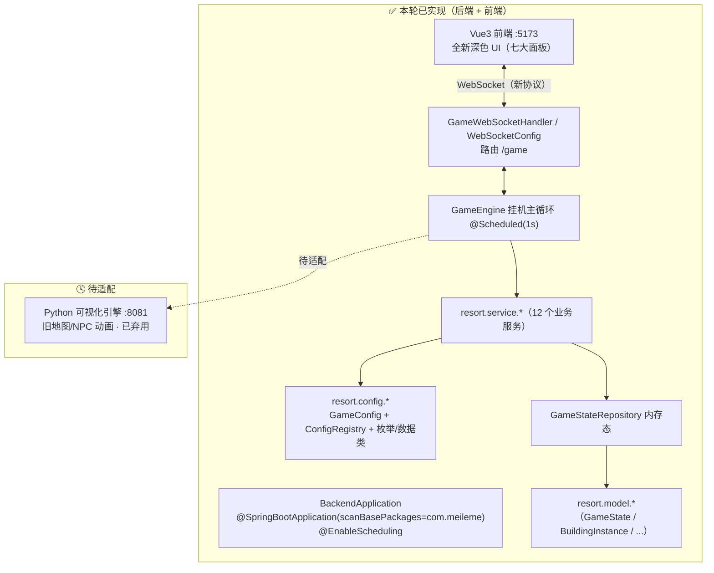

# 🏔️ 山间民宿度假村 · 挂机经营模拟系统（Meileme Resort）

纯**挂机经营**沙盘：开局后引擎连续实时仿真（现实 **1 分钟 = 游戏 1 天**，可 0.5~16x 倍速），
玩家随时下单，**所有操作统一「次日 0 点生效」**（进入待生效指令队列，生效时二次校验）。
本局为**无数值决策的挂机经营**——无定价权、无随机事件、无四季、无团建、无广告；
玩家做的是**建设 / 进化 / 内装 / 雇佣 / 技能**这一条长期成长线。

> **历史沿革（简述）**：本工程最初是「外卖调度模拟系统」（骑手 / 订单 / 派单 + Vue 地图 + Python 寻路可视化）；
> 其后整体改造为一版「度假村机制」（口碑 / 四季 / 随机事件 / 定价 / 团建 / 建筑停用拆除 / 旧 `BuildingType+StaffType`）；
> **本轮又彻底推翻该度假村机制，重做为全新玩法**：删除旧 `com.meileme.backend.*`（仅保留 `BackendApplication`），
> 新领域全部落在 `com.meileme.resort.*`。旧玩法（口碑、季节、事件、定价、团建、停用/拆除）均已移除。

> ⚠️ **本轮已完成后端玩法 + Vue3 前端全新深色 UI**（总览 / 区块 / 建筑 / 员工 / 技能 / 成就 / 日志 七大面板，全部基于新协议联调）。
> **Python 可视化引擎尚未适配新玩法**（旧地图 / A\* 寻路 / NPC 动画已弃用，本期无地形），属**待适配**状态。
> 当前可通过 `frontendweb`（Vue3 深色 UI）+ WebSocket 直连后端完整调试全部新玩法。
>
> ⚠️ **所有数值均为合理占位默认值**，处于「数值后期配置」阶段；**后续调参只改配置类**（`GameConfig` / `ConfigRegistry` / 各枚举），
> **业务代码内不硬编码任何数值**。

---

## 📌 一、整体架构总览

新后端为**单机单局内存态**：静态配置走 Java 配置类，运行时状态走内存仓储，逐日日志走内存环形队列。



| 层 | 端口 | 状态 | 职责 |
| :--- | :---: | :---: | :--- |
| Java 后端 | 8080 | ✅ 已实现 | **全部玩法与数值计算**、逐日 tick、财务结算、WebSocket 网关 |
| Vue3 前端 | 5173 | ✅ 已实现 | 全新深色 UI（总览 / 区块 / 建筑 / 员工 / 技能 / 成就 / 日志 七大面板），基于新协议 |
| Python 引擎 | 8081 | 🕓 待适配 | 旧地图生成 / A\* 寻路 / NPC 动画（本期无地形，已弃用） |
| Redis | 6379 | ❌ 不使用 | 新后端**不使用** Redis（`pom` 依赖仍在但业务代码零引用） |

**为什么本期不引入数据库**

- 单机单局、**无账号 / 无排行榜 / 无多人**需求 → 关系库与快照存储无收益；
- 静态配置（形态 / 配方 / 地块 / 成就 / 技能 / 景区）**全部落在 Java 配置类**，天然版本可控；
- 运行时状态走内存仓储、逐日日志走**内存环形队列（≤365 天）**，重启即失，符合「挂机单局」定位；
- 一旦出现**多玩家 / 审计回溯 / 排行榜**诉求，再引入 MySQL/PostgreSQL（持久化）或 Redis 快照（热状态）。

---

## 🕐 二、时间模型

| 项 | 规则 |
| :--- | :--- |
| 时间基准 | 现实 **1 分钟 = 游戏 1 天**（`REAL_SECONDS_PER_GAME_DAY = 60`） |
| 引擎 Tick | `TICK_INTERVAL_MS = 1000`（`@Scheduled(fixedRate=1000)` 推进时钟） |
| 时钟广播 | `@Scheduled(fixedRate=200)` 每 **200ms** 广播 `TIME_TICK`（**仅时间 / 进度 / 资金**，不含建筑员工大数组） |
| 倍速 | **0.5 / 1 / 2 / 4 / 8 / 16x**（`SPEED_OPTIONS`；默认 `1.0`） |
| 起始日 | `2026-07-01`（`DEFAULT_START_DATE`，**纯展示字段，不挂业务语义**） |
| 日志上限 | `REPORT_HISTORY_LIMIT = 365`（内存环形，超出裁剪最旧一条） |
| 破产判定 | 每次跨天日结后 **资金 ≤ 0** → 本局结束并广播 `GAME_OVER`（含末日收支明细） |

> **无随机事件、无四季系统**。时间只提供「日 + 日期展示 + 当日进度」，不携带任何季节 / 天气 / 事件语义。
> **局内进度重开全部清空**：新局直接重建 `GameState`，不残留上一局任何日志 / 实体。
> **建筑不可拆除、不可手动停用**（新玩法无此机制）。

---

## 🏗️ 三、建筑体系

### 3.1 母本与第一期可建范围

**住宿母本 6 种** + **配套母本 9 种**；**第一期仅「标准客房」可建造**（`MotherBuildingType.isPhase1Buildable()`），
其余母本**仅登记、不可建**（是否可建还受地块白名单二次约束）。

| 母本 | 类别 | 第一期可建 |
| :--- | :---: | :---: |
| `STANDARD_ROOM` 标准客房 | 住宿 | ✅ |
| `LUXURY_ROOM` 豪华客房 · `WOODEN_CABIN` 独栋木屋 · `DUPLEX_LOFT` 复式LOFT · `COURTYARD_HOUSE` 庭院小院 · `MULTI_BEDROOM_HOUSE` 多卧平房 | 住宿 | ❌ 仅登记 |
| `RESTAURANT` 餐厅 · `HOT_SPRING_POOL` 温泉泡池 · `VIEWING_PLATFORM` 观景台 · `RECEPTION_LOBBY` 接待大堂 · `TEA_LIBRARY` 茶室书吧 · `CULTURE_WORKSHOP` 文创工坊 · `LOGISTICS_WAREHOUSE` 后勤库房 · `OUTDOOR_CAMP` 户外营地 · `PARENT_CHILD_PARK` 亲子乐园 | 配套 | ❌ 仅登记 |

### 3.2 形态（BuildingForm）

- 每个形态自带等级 **Lv1~Lv3**（`FORM_MIN_LEVEL`/`FORM_MAX_LEVEL`）；**形态满级（Lv3）后才可进行下一阶段分支进化**。
- 形态固有属性：**客群影响系数**（`affinity`，**形态固有、内装不提供**）、每间可接待人数、每间固定房价、每日维护费、
  基础舒适度、能力需求、各等级内装上限。
- 等级加成：分配权重 `1 + 0.20 × (level − 1)`；基础舒适度 `baseComfort × (1 + 0.15 × (level − 1))`。

**已配置形态（`ConfigRegistry`）**

| 形态 ID | 名称 | 进化线 | tier | 每间人数 | 房价 Lv1/2/3 | 维护费 Lv1/2/3 | 基础舒适 | 内装上限 |
| :--- | :--- | :---: | :---: | :---: | :--- | :--- | :---: | :---: |
| `STANDARD_ROOM` | 标准客房 | BASE | 0 | 2 | 280 / 330 / 380 | 120 / 140 / 160 | 50 | 1/2/3 |
| `FAMILY_ROOM` | 家庭亲子房 | FAMILY | 1 | 4 | 500 / 580 / 660 | 180 / 210 / 240 | 62 | 2/3/3 |
| `FAMILY_SUITE` | 亲子套房 | FAMILY | 2 | 6 | 760 / 880 / 1000 | 260 / 300 / 340 | 76 | 2/3/3 |
| `BUSINESS_ROOM` | 商务行政房 | BUSINESS | 1 | 2 | 620 / 720 / 820 | 200 / 230 / 260 | 64 | 2/3/3 |
| `BUSINESS_SUITE` | 行政套房 | BUSINESS | 2 | 3 | 950 / 1100 / 1250 | 280 / 320 / 360 | 80 | 2/3/3 |
| `MERGED_FAMILY_VILLA` | 亲子合院 | MERGE | 3 | 10 | 1500 / 1750 / 2000 | 420 / 480 / 540 | 95 | 3/3/3 |
| `MERGED_BUSINESS_HALL` | 商务行政馆 | MERGE | 3 | 8 | 1600 / 1850 / 2100 | 440 / 500 / 560 | 98 | 3/3/3 |

**其余母本基础形态（仅登记备用，tier=0；数值同样集中在配置类）**

- 住宿（每间人数 / 房价Lv1 / 建造成本 / 维护Lv1）：`LUXURY_ROOM` 豪华客房 4 / 680 / 8000 / 350；
  `WOODEN_CABIN` 独栋木屋 4 / 720 / 12000 / 500；`DUPLEX_LOFT` 复式LOFT 5 / 860 / 10000 / 420；
  `COURTYARD_HOUSE` 庭院小院 6 / 1100 / 15000 / 600；`MULTI_BEDROOM_HOUSE` 多卧平房 8 / 1250 / 11000 / 450。
- 配套（服务容量 / 单价Lv1 / 建造成本 / 维护Lv1）：`RESTAURANT` 餐厅 40 / 80 / 6000 / 220；
  `HOT_SPRING_POOL` 温泉泡池 20 / 60 / 7500 / 280；`VIEWING_PLATFORM` 观景台 30 / 40 / 4000 / 150；
  `RECEPTION_LOBBY` 接待大堂 0 / 0 / 5000 / 180；`TEA_LIBRARY` 茶室书吧 15 / 50 / 4500 / 160；
  `CULTURE_WORKSHOP` 文创工坊 12 / 55 / 5500 / 200；`LOGISTICS_WAREHOUSE` 后勤库房 0 / 0 / 3500 / 140；
  `OUTDOOR_CAMP` 户外营地 25 / 35 / 3000 / 120；`PARENT_CHILD_PARK` 亲子乐园 35 / 45 / 6500 / 240。

> **接待大堂 / 后勤库房**的**服务容量与单价均为 0**（仅贡献吸引力，不产生配套收入）。

### 3.3 内装（InteriorType）

内装分两类：**承载型**（提供容量 + 舒适度）与**普通型**（仅舒适度）。**内装不提供客群系数**；
底层预留了扩展字段，**当前不启用额外语义**。形态等级决定该形态下的内装等级上限（见上表「内装上限」）。

| 内装 ID | 名称 | 类型 | 每级舒适度 | 每级容量 | 升级花费 Lv1/2/3 |
| :--- | :--- | :---: | :---: | :---: | :--- |
| `BED` | 床位 | 承载型 | 3.0 | 1.0 | 800 / 1500 / 2500 |
| `DINING_TABLE` | 餐桌 | 承载型 | 2.0 | 2.0 | 600 / 1200 / 2000 |
| `HOT_SPRING_TUB` | 泡池 | 承载型 | 3.0 | 1.5 | 1200 / 2200 / 3600 |
| `SOFA` | 沙发 | 普通型 | 2.0 | 0 | 400 / 800 / 1400 |
| `LIGHTING` | 灯具 | 普通型 | 1.5 | 0 | 300 / 600 / 1000 |
| `DECOR` | 软装 | 普通型 | 2.5 | 0 | 500 / 1000 / 1800 |

### 3.4 两大进化体系（互不互斥）

| 体系 | 规则 |
| :--- | :--- |
| **BRANCH_EVOLVE 分支进化** | 单体进化：**形态满级（Lv3）后**选定进化线。标准客房 → **家庭亲子线**（家庭亲子房→亲子套房）/ **商务行政线**（商务行政房→行政套房）。**分支选定后不可切换、不可回退**；进化后形态回到 Lv1。受地块 `evolveTierCap` 限制。MERGE 产物不可再分支。 |
| **MERGE_EVOLVE 合并进化** | **预设固定配方**：消耗两个源建筑 → 新建一个产物。源建筑**逻辑删除、保留墓碑记录**；产物记录合并来源建筑 ID，支持**跨母本**（框架完整支持，第一期配方落在标准客房线内）。 |

**合并配方（`MergeRecipe`）**

| 配方 ID | 源 A | 源 B | 产物 | 花费 |
| :--- | :--- | :--- | :--- | ---: |
| `MERGE_FAMILY_VILLA` | 亲子套房 Lv3 | 亲子套房 Lv3 | 亲子合院 Lv1 | 30000 |
| `MERGE_BUSINESS_HALL` | 行政套房 Lv3 | 行政套房 Lv3 | 商务行政馆 Lv1 | 32000 |
| `MERGE_CROSS_LINE_HALL` | 亲子套房 Lv3 | 行政套房 Lv3 | 商务行政馆 Lv1 | 40000 |

> `MERGE_CROSS_LINE_HALL` 为**跨线合并演示**配方（家庭线 × 商务线 → 商务行政馆）。

---

## 👥 四、客流与房型需求（核心链路）

景区（`ScenicConfig`「云栖山谷景区」）固定客群比例：**家庭 0.35 / 商务 0.25 / 浪漫 0.20 / 康养 0.20**；每日基础客流基数 **60**。

**链路（`DemandService.compute`）**

```
① 各客群潜在客流   = 基数 × 客群占比
② 分客群吸引力     = Σ 综合全部建筑[ 形态客群匹配系数 × 综合舒适度 × 形态等级加成 ] × 引流技能倍率
   转化率           = clamp( 吸引力 / 400 × 转化率技能倍率 , 0 , 0.90 )
   意向客流         = 潜在客流 × 转化率
③ 按权重分配       = 意向客流 × [ 本建筑权重 / 同客群全部住宿建筑权重之和 ]
④ 床位容量截断     = 分配人数之和 > 容量 → 等比缩小
⑤ 溢出客流         = 意向客流 − 实际接待   → 直接流失，不做二次分流
```

- **全程无价格竞争、玩家无定价权**：不存在价格弹性 / 广告 / 口碑修正，只有「吸引力 → 转化率 → 分配 → 容量」。
- 综合舒适度 = 形态基础舒适度（含形态等级加成）+ 内装舒适度，再乘**人力供给系数**（见第六节）。

### 4.1 按「间」计价的语义（已确认）

- **建筑实例 = 一间房**；容量 = 该形态每间可接待人数（+ 承载型内装附加容量）。
- **分配人数 > 0 即该间售出**；**入住不满整间也按整间房价计**。
- 住宿收入 = `Σ( 售出间数 × 该形态该等级固定房价 × 房晚单价技能倍率 )`。

**示例**：2 间标准客房（2 人/间，¥280）+ 1 间亲子房（4 人/间，¥500），实际分到 3 / 2 人 →
标准客房有 2 间分配人数 > 0 → 2 间售出 = `2 × 280 = 560`；亲子房 1 间售出 = `500`；**住宿收入 = 1060**。

---

## 🛎️ 五、配套消费

- 每个配套有独立的**服务容量上限**；
- 配套当日**服务人次 = min(全局入住总人数, 配套服务容量上限)**；
- 配套收入 = `服务人次 × 该形态固定基准消费单价 × 配套单价技能倍率`；
- **接待大堂 / 后勤库房**：容量与单价均为 **0**（**仅贡献吸引力**，不产生收入）。

---

## 🧑🔧 六、雇佣系统

**全局共享人力池**，按能力维度汇总「**员工总供给能力 vs 全部建筑总需求能力**」：

- **供给不足仅降低相关建筑舒适度（下限比例 0.30）**，**不削减承载容量**；
- 单个员工可拥有**多项能力**并**同时计入多项**（复合能力）；
- 能力值由**等级固定、无随机浮动**；
- **无高阶建筑对员工等级的硬门槛**（等级只影响能力供给与薪资）。

**岗位（6）**（`PositionType`）

| 岗位 ID | 名称 | 提供能力 | 薪资 Lv1/2/3 | 能力值 Lv1/2/3 | 招聘基准 | 升级天数1→2 / 2→3 | 解雇补偿基准 |
| :--- | :--- | :--- | :--- | :--- | ---: | :---: | ---: |
| `ROOM_CLEANER` | 客房保洁 | 客房清洁 | 100 / 160 / 240 | 30 / 55 / 85 | 400 | 10 / 20 | 600 |
| `WAITER` | 餐厅服务员 | 餐厅服务 | 110 / 170 / 250 | 30 / 55 / 85 | 400 | 10 / 20 | 600 |
| `CHEF` | 厨师 | 烹饪 | 200 / 320 / 460 | 35 / 60 / 90 | 800 | 12 / 24 | 1200 |
| `HOT_SPRING_OPERATOR` | 温泉运维员 | 温泉运营 | 130 / 200 / 290 | 30 / 55 / 85 | 500 | 10 / 20 | 700 |
| `MAINTENANCE_WORKER` | 综合维修员 | 客房维修 + 温泉维修 | 150 / 230 / 330 | 25 / 45 / 70 | 600 | 12 / 24 | 900 |
| `MANAGER` | 店长 | 全局管理 | 300 / 450 / 650 | 40 / 70 / 100 | 1500 | 15 / 30 | 2000 |

> 店长的「全局管理」能力**本期暂不启用加成**。

**建筑能力需求**：标准客房系列 = {客房清洁, 客房维修}；餐厅 = {餐厅服务, 烹饪}；温泉 = {温泉运营, 温泉维修}。

**操作规则**

| 操作 | 规则 |
| :--- | :--- |
| **招聘** | 指定岗位 + 目标等级，**必定成功**；花费 = `岗位 hireCost × 等级系数`（Lv1=基准，Lv2=2×，Lv3=3×）。 |
| **解雇** | **无冷却**；补偿 = `岗位 compensationBase × 等级系数 × (1 + 在岗累计天数 × 0.005)`；**复合能力员工按主岗位计算、不叠加**。 |
| **薪资** | 员工每日按「岗位 + 等级」结算薪资。 |
| **自动升级** | 在岗累计游戏日达标（阈值按「岗位 × 等级区间」配置）→ 自动升级；升级后**能力值按新等级固定值刷新**。 |

---

## 💰 七、成本与结算

**每日运营成本仅两项**：全部建筑每日维护费 + 全部员工每日薪资。
（耗材 / 水电 / 洗涤 / 食材**全部并入建筑维护费**，不单列。）

| 项 | 公式 |
| :--- | :--- |
| 当日总收入 | 住宿收入 + 配套收入 |
| 当日总支出 | 建筑总维护费 + 员工总薪资 |
| 当日净利润 | 总收入 − 总支出 |
| 资金池 | `资金池 += 净利润` |
| 破产判定 | 每次跨天日结后 **资金 ≤ 0** → 本局结束并广播 `GAME_OVER`（含末日收支明细） |

**一次性支出**：新建建筑费、形态进化费、内装升级费、员工解雇补偿金。

> 舒适度**仅参与客流转化**，**不二次折损收入**。

---

## 🔁 八、每日循环（伪代码）

```
scheduledLoop() 每 1000ms:
    if 未运行 / 已破产 / 已暂停: return
    dayProgress += (1000ms→1s) × speed / REAL_SECONDS_PER_GAME_DAY
    while dayProgress >= 1.0:
        dayProgress -= 1.0
        closeDay()          # 当日日结
        if 未破产: beginDay()  # 次日 0 点：应用待生效指令

# ---- 每日 8 步（closeDay 核心）----
① 刷新景区每日基础客流                  # = 60（ScenicConfig.baseDailyFlow）
② 计算全局吸引力、生成各客群意向客流      # 吸引力→转化率→意向
③ 权重分配客流至各房型                  # 按「系数×舒适度×等级加成」份额分配
④ 床位容量截断得最终入住人数             # 超出等比缩小，溢出直接流失
⑤ 计算配套当日服务人次                  # min(全局入住总人数, 配套容量)
⑥ 结算住宿 + 配套收入                   # 售出间数×房价 + 服务人次×单价
⑦ 结算当日运营成本                      # 建筑维护费 + 员工薪资
⑧ 更新资金池 / 员工在岗时长 / 建筑状态    # += 净利润；员工在岗+1、达标自动升级
   → 统计刷新 → 成就解锁 → 区块解锁 → 完成当日挂机结算
```

**玩家操作 → 生效（`applyPendingCommands`，次日 0 点）**

```
玩家下单（立即做前置校验）
  └─ 通过 → 进入「待生效指令队列」→ 广播 ACTION_QUEUED（含 effectiveDay）
  └─ 拒绝 → 广播 ACTION_FAILED{reason}

beginDay() 次日 0 点:
  for cmd in 队列:
     二次校验（资金 / 建筑存在性 / 地块 / 等级 / 配方 ...）
     └─ 通过 → 执行
     └─ 失败 → 广播 ACTION_FAILED{action, description, reason}
  清空队列
```

---

## 🗺️ 九、区块解锁与成就

**大区域**：A 村 / B 镇，各含 **3 个地块**。开局**仅开放 A村·乡间地块**。

- 每地块独立配置：**可建造住宿母本白名单** / **配套母本白名单** / **分支进化进阶上限（tier cap）** / **建筑数量上限**；
- 达成指定成就后**依次解锁同区域后续地块**；
- **A 村总成就（`ACH_A_TOTAL`，累计收入 30 万）**达成后**解锁 B 镇**；
- 成就**全局跨区域累计、新区域不重置**；
- **每解锁一个地块发放 1 技能点**（`SKILL_POINT_PER_PLOT`）。

**地块清单（`Plot`）**

| 地块 ID | 名称 | 区域 | 建筑上限 | tier cap | 解锁条件 | 住宿白名单 | 配套白名单 |
| :--- | :--- | :---: | :---: | :---: | :--- | :--- | :--- |
| `A_COUNTRYSIDE` | A村·乡间地块 | A村 | 8 | 1 | **默认解锁** | 标准客房 | 餐厅, 观景台 |
| `A_HILLSIDE` | A村·山坡地块 | A村 | 10 | 2 | `ACH_BUILDING_20` | 标准客房 | 餐厅, 温泉泡池 |
| `A_LAKESIDE` | A村·湖区地块 | A村 | 12 | 3 | `ACH_GUEST_500` + `ACH_INCOME_100000` | 标准客房 | 餐厅, 温泉泡池, 观景台 |
| `B_COUNTRYSIDE` | B镇·乡间地块 | B镇 | 12 | 2 | `ACH_A_TOTAL` + `ACH_BUILDING_40` | 标准客房, 豪华客房 | 餐厅, 接待大堂 |
| `B_HILLSIDE` | B镇·山坡地块 | B镇 | 14 | 3 | `ACH_A_TOTAL` + `ACH_GUEST_2000` | 标准客房, 豪华客房, 独栋木屋 | 餐厅, 温泉泡池, 茶室书吧 |
| `B_LAKESIDE` | B镇·湖区地块 | B镇 | 16 | 3 | `ACH_A_TOTAL` + `ACH_INCOME_1000000` | 标准客房, 豪华客房, 庭院小院 | 餐厅, 温泉泡池, 观景台 |

**成就（共 13 个，四类指标）**

| 指标大类 | 判定类型 | 涉及成就 |
| :--- | :--- | :--- |
| 财务 | 总资产 / 累计总收入 | 累计总收入 10 万 / 总资产 10 万 / A村总成就 30 万 / 累计总收入 100 万 |
| 建筑 | 已建建筑总数 / 特定形态等级 | 已建建筑 20 座 / 已建建筑 40 座 / 建成亲子套房 Lv1 / 建成亲子合院 Lv1 |
| 客流 | 累计接待总人数 / 特定客群累计接待 | 累计接待 500 人 / 累计接待 2000 人 / 家庭客群累计接待 300 人 |
| 雇佣 | 员工总数 / 特定岗位等级 | 员工总数 10 人 / 拥有 Lv3 厨师 |

完整 ID：`ACH_INCOME_100000`、`ACH_ASSETS_100000`、`ACH_A_TOTAL`、`ACH_INCOME_1000000`、
`ACH_BUILDING_20`、`ACH_BUILDING_40`、`ACH_FORM_FAMILY_SUITE`、`ACH_FORM_MERGED_VILLA`、
`ACH_GUEST_500`、`ACH_GUEST_2000`、`ACH_SEG_FAMILY_300`、`ACH_STAFF_10`、`ACH_POS_CHEF_LV3`。

---

## 🌳 十、局内技能树

- **单局成长、重开清空**；
- 拓扑为 **DAG，绝对禁止循环依赖**；每节点 1~N 前置，**全部前置解锁后才可解锁**；**不支持洗点**；
- 效果仅两类：**倍率加成（MULTIPLIER）/ 费用减免（COST_DISCOUNT）**，外加少量**固定加成（FLAT）**；
- **技能点唯一来源 = 局内里程碑（每解锁一个地块 +1）**；
- **聚合口径**：`MULTIPLIER = Π(1 + value)` ； `COST_DISCOUNT = Π(1 − value)` ； `FLAT = Σ value`。

**六大类 · 已配置 19 个节点（`SkillNode`）**

| 类别 | 技能 ID | 名称 | 效果 | 类型 | 数值 | 前置 |
| :--- | :--- | :--- | :--- | :---: | :---: | :--- |
| 建筑进化 | `SK_EVOLVE_COST` | 进化节流 I | 形态进化费用 −10% | DISCOUNT | 0.10 | — |
| 建筑进化 | `SK_EVOLVE_COST_II` | 进化节流 II | 形态进化费用再 −10% | DISCOUNT | 0.10 | `SK_EVOLVE_COST` |
| 建筑进化 | `SK_MERGE_COST` | 合并节流 I | 合并进化消耗 −15% | DISCOUNT | 0.15 | `SK_EVOLVE_COST` |
| 建筑进化 | `SK_PLOT_LIMIT` | 地块扩容 I | 单地块建筑上限 +2 | FLAT | 2.0 | `SK_EVOLVE_COST` |
| 建筑进化 | `SK_MERGE_BONUS` | 合并专精 | 合并产物房价 +10% | FLAT | 0.10 | `SK_MERGE_COST` |
| 内装 | `SK_INTERIOR_COST` | 内装节流 I | 内装升级费用 −10% | DISCOUNT | 0.10 | — |
| 内装 | `SK_INTERIOR_COMFORT` | 舒适内装 I | 内装舒适度加成 +15% | MULTIPLIER | 0.15 | `SK_INTERIOR_COST` |
| 内装 | `SK_INTERIOR_CAPACITY` | 承载内装 I | 内装承载加成 +15% | MULTIPLIER | 0.15 | `SK_INTERIOR_COST` |
| 客流 | `SK_ATTRACT` | 引流 I | 分客群吸引力 +10% | MULTIPLIER | 0.10 | — |
| 客流 | `SK_CONVERSION` | 转化率 I | 客群转化率 +15% | MULTIPLIER | 0.15 | `SK_ATTRACT` |
| 雇佣人力 | `SK_HIRE_COST` | 招聘节流 I | 招聘消耗 −10% | DISCOUNT | 0.10 | — |
| 雇佣人力 | `SK_STAFF_ABILITY` | 人力素质 I | 员工能力值 +15% | MULTIPLIER | 0.15 | `SK_HIRE_COST` |
| 雇佣人力 | `SK_STAFF_TRAIN` | 岗前培训 I | 员工自动升级所需在岗时长 −15% | DISCOUNT | 0.15 | `SK_HIRE_COST` |
| 雇佣人力 | `SK_STAFF_SALARY` | 薪资优化 I | 员工每日薪资 −10% | DISCOUNT | 0.10 | `SK_HIRE_COST` |
| 雇佣人力 | `SK_FIRE_COMP` | 离职安抚 | 解雇补偿 −20% | DISCOUNT | 0.20 | `SK_STAFF_ABILITY` |
| 财务结算 | `SK_ROOM_PRICE` | 房价溢价 I | 房晚基准单价 +5% | MULTIPLIER | 0.05 | — |
| 财务结算 | `SK_SUPPORT_PRICE` | 配套溢价 I | 配套基准单价 +5% | MULTIPLIER | 0.05 | `SK_ROOM_PRICE` |
| 财务结算 | `SK_MAINTENANCE` | 运维节流 I | 建筑维护成本 −10% | DISCOUNT | 0.10 | `SK_ROOM_PRICE` |
| 区块解锁 | `SK_REGION_GATE` | 区块通达 I | 区块解锁所需成就门槛 −10% | DISCOUNT | 0.10 | — |

---

## 🔌 十一、WebSocket 协议（`ws://localhost:8080/game`）

### 客户端 → 服务端（`{ "command": "...", ... }`）

| 指令 | 参数 | 说明 |
| :--- | :--- | :--- |
| `START_GAME` | — | 开新局（重建 `GameState`，清空上一局） |
| `STOP_GAME` | — | 结束对局 |
| `PAUSE_GAME` / `RESUME_GAME` | — | 暂停 / 继续（兜底） |
| `CHECK_STATUS` / `GET_STATUS` | — | 拉取状态（仅回请求方全量同步） |
| `GET_CONFIG` | — | 拉取静态配置（形态 / 配方 / 地块 / 成就 / 技能 / 景区） |
| `SET_SIMULATION_SPEED` | `speed` | 0.5 / 1 / 2 / 4 / 8 / 16 |
| `BUILD_BUILDING` | `buildingType`, `plotId` | 新建建筑（次日 0 点生效） |
| `FORM_LEVEL_UP` | `buildingId` | 形态等级升级 Lv1→Lv2→Lv3 |
| `BRANCH_EVOLVE` | `buildingId`, `targetFormId` | 分支进化（满级后选定线） |
| `MERGE_EVOLVE` | `buildingIdA`, `buildingIdB` | 合并进化（按配方二建一） |
| `INTERIOR_UPGRADE` | `buildingId`, `interiorType` | 内装升级 |
| `HIRE_STAFF` | `position`, `level` | 招聘（必定成功） |
| `FIRE_STAFF` | `staffId` | 解雇（无冷却） |
| `UNLOCK_SKILL` | `skillId` | 解锁局内技能 |
| `REQUEST_DAILY_LOG` | — | 请求本局逐日日志（内存环形，**只回请求方**） |
| `REQUEST_RANGE_REPORT` | `rangeDays` | 区间报告（1 / 7 / 30 / 365 天，**只回请求方**） |

### 服务端 → 客户端（`{ "type": "...", ... }`）

| 消息 | 载荷 / 说明 |
| :--- | :--- |
| `CONFIG` | 静态配置全量（开局与新连接时下发）：`scenic` / `buildingForms` / `mergeRecipes` / `plots` / `achievements` / `skills` / `speedOptions` / `formMaxLevel` / `staffMaxLevel`，以及**结构化目录** `mothers` / `segments` / `abilities` / `positions` / `interiors`（均含 `id` 与 `displayName` 等展示字段） |
| `RESORT_STATE` | 全量状态（资金 / 日 / 日期 / 建筑 / 员工 / 技能点 / 已解锁技能地块区域成就 / 待生效指令 / 统计 / 末日结），另含 **今日预计 `todayPreview` / 里程碑 `milestones` / 能力供需 `abilitySupply·abilityDemand·abilityRatios` / 解雇补偿 `staffCompensations`** |
| `TIME_TICK` | `{day, date, progress, speed, paused, funds}`（**约 200ms 广播，仅时间 / 进度 / 资金**） |
| `DAY_STARTED` | `{day, date, unlocks}` |
| `DAY_SETTLED` | `{day, funds, settle}`（日结快照，含收支 / 客流 / 事件） |
| `ACTION_QUEUED` | `{action, commandId, description, effectiveDay}` |
| `ACTION_FAILED` | `{action, commandId, description, reason}` |
| `GAME_OVER` | `{reason, day, lastSettle, historySize}` |
| `GAME_STOPPED` | `{reason}` |
| `DAILY_LOG` | `{history: DailySettle[]}`（只回请求方） |
| `RANGE_REPORT` | `{rangeDays, days, totalRevenue, totalExpense, netProfit, totalGuests, overflowGuests, avgOccupancyRate, slices}`（只回请求方） |

### 失败原因枚举（示例）

`GAME_NOT_RUNNING`、`INSUFFICIENT_FUNDS`、`MOTHER_NOT_BUILDABLE_IN_PHASE_1`、`MOTHER_NOT_ALLOWED_IN_PLOT`、
`PLOT_NOT_UNLOCKED`、`PLOT_BUILD_LIMIT_REACHED`、`FORM_NOT_MAX_LEVEL`、`EVOLVE_LINE_LOCKED`、
`EVOLVE_PATH_NOT_ALLOWED`、`PLOT_EVOLVE_TIER_CAP_EXCEEDED`、`MERGE_RECIPE_NOT_MATCHED`、
`INTERIOR_LEVEL_CAP_REACHED`、`FORM_LEVEL_MAX_REACHED`、`NO_SKILL_POINT`、`PREREQUISITE_NOT_UNLOCKED`。

### JSON 样例

```json
{ "command": "BUILD_BUILDING", "buildingType": "STANDARD_ROOM", "plotId": "A_COUNTRYSIDE" }
```
```json
{ "command": "MERGE_EVOLVE", "buildingIdA": "BLD-a1", "buildingIdB": "BLD-b2" }
```
```json
{ "type": "ACTION_QUEUED", "action": "BUILD", "commandId": "CMD-7d8e9f", "description": "新建 标准客房 @ A_COUNTRYSIDE", "effectiveDay": 2 }
```
```json
{ "type": "ACTION_FAILED", "action": "BRANCH_EVOLVE", "commandId": "CMD-1a", "reason": "FORM_NOT_MAX_LEVEL" }
```

---

## 📁 十二、工程结构

```
meileme/
├── backendjava/                          # ✅ Java 挂机后端 (:8080)
│   ├── pom.xml                           # Spring Boot 3.2.4 + WebSocket + Jackson（+ 未被新业务使用的 redis 依赖）
│   └── src/main/java/com/meileme/
│       ├── backend/BackendApplication.java   # 仅保留：scanBasePackages=com.meileme + @EnableScheduling
│       └── resort/
│           ├── config/      # 数值配置（唯一来源）：GameConfig、ConfigRegistry、BuildingForm、
│           │                #   MotherBuildingType、InteriorType、MergeRecipe、EvolutionLine、ScenicConfig、
│           │                #   CustomerSegment、AbilityType、PositionType、Plot、Region、Achievement、
│           │                #   SkillNode、PendingCommandType 等
│           ├── model/       # 内存实体：GameState、GameStats、DailySettle、DemandResult、PendingCommand、
│           │                #   BuildingInstance、InteriorInstance、StaffInstance
│           ├── repository/  # GameStateRepository（内存态）
│           ├── service/     # ConfigRegistry、GameEngine、DemandService、ComfortService、FinanceService、
│           │                #   StaffService、ConstructionService、EvolutionService、InteriorService、
│           │                #   SkillTreeService、AchievementService、RegionService、StatsService、IdGenerator
│           └── websocket/   # GameWebSocketHandler + WebSocketConfig（路由 /game）
├── backendpython/                        # 🕓 待适配（旧地图/NPC 可视化，本期无地形、已弃用）
└── frontendweb/                          # ✅ Vue3 全新深色 UI（已适配新协议）
    └── src/
        ├── main.js                       # 入口（挂载 App）
        ├── style.css                     # 深色主题 CSS 变量 + 布局/面板/进度条/弹窗/toast/漂移动画
        ├── App.vue                       # 6 tab（总览/区块/建筑/员工/技能/成就）+ 结算日志 + 破产弹窗
        ├── services/
        │   ├── WebSocketClient.js        # ws://localhost:8080/game，下行 {type} / 上行 {command}
        │   └── store.js                  # reactive 全局态 + api 指令封装 + reason 中文映射 + config 索引
        ├── utils/
        │   ├── format.js                 # 金额整数千分位格式化
        │   └── guestAnimation.js         # 游客光点纯 CSS 漂移（前端简化模拟）
        └── components/
            ├── common/                   # Modal / ProgressBar / Toast
            ├── overview/                 # StatusBar / DayPreview / PlotMapView / BuildingIcon / BuildSlot
            ├── region/                   # RegionPanel / AchievementProgress
            ├── building/                 # BuildModal / BuildingDetailModal / BuildingListPanel
            ├── staff/                    # StaffPanel
            ├── skill/                    # SkillTreePanel（SVG 分层 DAG 布局）
            └── log/                      # SettlementLogModal（逐日日志 + 区间报告）
```

---

## 🚀 十三、快速启动

```bash
# ✅ 后端（Java 玩法 + 数值中枢）
cd backendjava && mvn spring-boot:run
# 服务：http://localhost:8080    WebSocket：ws://localhost:8080/game

# ✅ 前端（Vue3 全新深色 UI，须先启动后端）
cd frontendweb && npm install && npm run dev    # :5173

# 🕓 Python 可视化引擎（旧地图/NPC 动画，本期无地形，暂不建议联调）
# cd backendpython && python3 -m uvicorn main:app --port 8081
```

**调试流程（推荐走前端 UI）**：浏览器打开 `http://localhost:5173` → 顶部「开始一局」→ 建造标准客房 → 等待次日 0 点生效与日结
→ 后续形态升级 / 分支进化 / 合并进化 / 内装升级 / 招聘 / 技能解锁均可在对应面板操作，实时查看「今日预计 / 能力供需 / 里程碑 / 成就进度」。
（也可纯 WebSocket 直连 `ws://localhost:8080/game` 手动排指令：发 `START_GAME` → 收 `CONFIG`/`RESORT_STATE` → 发 `BUILD_BUILDING` → 收 `ACTION_QUEUED` → 次日收 `DAY_SETTLED`。）

---

> 本文档以**真实代码事实**为准；新玩法数值集中在 `GameConfig` 与 `ConfigRegistry`（及各枚举），
> 均为**占位默认值**，调参只改配置类。Python 可视化引擎适配完成后，将同步更新本 README。
