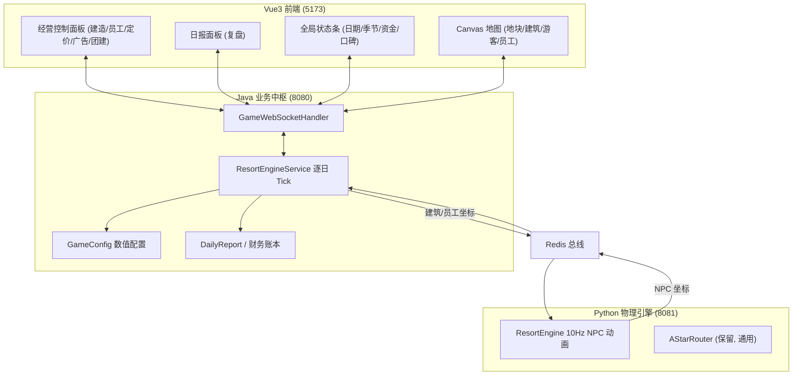

# 山间民宿度假村挂机经营游戏 — 改造方案（评审稿）

> 本文件是 **task C（外卖模拟器 → 山间民宿度假村挂机经营游戏）** 的第一阶段交付物。
> 按约定：**本稿只做方案 + 代码供你审阅，暂不落地写任何源文件**；确认后我再实施三端改造并同步更新根目录 `README.md`。
>
> 请重点看 **§9 待确认清单**（🟡 标记为 PRD 未明确、由我补充设计的规则）。

---

## 0. 交付说明

| 项 | 说明 |
| :--- | :--- |
| 保留 | Java SpringBoot(:8080) 业务层 / 虚拟时间 tick / 财务账本 / WebSocket 双向通信 / Redis 总线；Python FastAPI(:8081) 物理引擎 / A\* 寻路；Vue3 + Canvas 地图渲染 |
| 删除 | 骑手、外卖订单、商家（含加盟费/评分/出单模型）、派单（AUTO/MANUAL）、巡游、超时失效、骑手提成/平台抽成 |
| 新增 | 度假村经营实体、配置类、逐日 tick 经营闭环、日报、随机事件、团建大单、地块解锁、经营控制面板 |
| 原则 | ① 所有数值集中在 `GameConfig` / 枚举，业务代码零硬编码；② 游客/员工 A\* 移动**仅前端可视化**，不参与任何业务数值；③ 游戏运行（仿真）期间玩家零干预 |

---

## 1. 改造总览



**核心循环（一个游戏日）**

```
游戏日 D 00:00
  ├─ 结算并广播上一日日报 (DAILY_REPORT)  ← 玩家"上线看日报复盘"
  ├─ 生成当日散客需求 + 0~2 笔团建大单
  ├─ 阶段 = AWAITING_DECISION（时钟暂停，玩家"上线做经营配置"）
  │    └─ 玩家：建造/招解雇/调价/调广告 + 接受/拒绝每笔团建单 → 点击【开始今日仿真】
  ├─ 阶段 = RUNNING（现实 4 小时 × 倍速 = 1 游戏日，玩家零干预）
  │    └─ Python 动画游客/员工走动（纯可视化）；Java 不读玩家任何实时输入
  └─ 当日 24:00 → 结算 → 生成日报 → 回到 00:00
```

---

## 2. 数值配置类（`GameConfig`，唯一数值来源）

**新增文件**：`backendjava/src/main/java/com/meileme/backend/config/GameConfig.java`

```java
package com.meileme.backend.config;

/** 全局游戏数值配置：所有经营数值的唯一来源，业务代码禁止硬编码。 */
public final class GameConfig {
    private GameConfig() {}

    // ===== 局基础 =====
    public static final double INITIAL_CASH        = 20000.0;
    public static final double INITIAL_REPUTATION  = 70.0;
    public static final double REPUTATION_MIN      = 0.0;
    public static final double REPUTATION_MAX      = 100.0;
    public static final double BANKRUPTCY_CASH     = 0.0;   // 资金 <= 0 破产

    // ===== 时间 =====
    public static final long BASE_VIRTUAL_TIME_MS      = 1782835200000L; // 2026-07-01 00:00:00
    public static final long GAME_DAY_VIRTUAL_MS       = 24L * 3600 * 1000;
    public static final long VIRTUAL_MS_PER_REAL_SECOND = 6000L;          // 现实1秒=游戏6秒 ⇒ 现实4小时=1游戏日
    public static final int  SEASON_LENGTH_DAYS        = 30;              // 每 30 游戏天换季
    public static final long DECISION_TIMEOUT_REAL_MS  = 300_000L;        // 决策窗口超时(现实5分钟)后自动拒绝未决团建单 🟡

    // ===== 散客客流 =====
    public static final double BASE_GUESTS_PER_DAY      = 60.0;
    public static final double REP_BASELINE             = 70.0; // 口碑基准(该点客流系数=1.0)
    public static final double REP_TRAFFIC_PER_POINT    = 0.01; // 口碑每 ±1 点 → 客流 ±1%
    public static final double LOW_REP_THRESHOLD        = 50.0; // 口碑低于该值"大幅衰减"
    public static final double LOW_REP_DECAY_FACTOR     = 0.50; // 衰减系数 🟡
    public static final double AD_TRAFFIC_PER_1000      = 0.15; // 每 1000 元广告 → +15% 客流
    public static final double AD_TRAFFIC_CAP           = 0.80; // 广告加成上限 +80%
    public static final double LUX_GUEST_PREFERENCE     = 0.30; // 过夜客中 30% 偏好豪华套房 🟡
    public static final double NO_FRONT_DESK_FACTOR     = 0.75; // 缺前台 → 入住率 -25%

    // ===== 单客消费 =====
    public static final double DINING_SPEND_PER_GUEST     = 80.0;
    public static final double RECREATION_SPEND_PER_GUEST = 60.0;

    // ===== 员工倍率 =====
    public static final double STAFF_HIGH_SALARY_MULT = 1.30;
    public static final double STAFF_HIGH_EFFICIENCY  = 1.20;
    public static final double STAFF_HIGH_NEG_MULT    = 0.50;
    public static final double STAFF_LOW_SALARY_MULT  = 0.70;
    public static final double STAFF_LOW_EFFICIENCY   = 0.80;
    public static final double STAFF_LOW_NEG_MULT     = 2.00;
    public static final double CLEANING_ROOMS_PER_STAFF     = 10.0; // 每 10 间客房需 1 名保洁 🟡
    public static final double CLEANING_SHORTAGE_REP_PENALTY = 2.0;  // 保洁不足每日口碑惩罚 🟡

    // ===== 随机事件触发概率 =====
    public static final double EVENT_RAINSTORM_PROB      = 0.12; // 暴雨
    public static final double EVENT_PIPE_BURST_PROB     = 0.08; // 水管爆裂
    public static final double EVENT_INFLUENCER_PROB     = 0.07; // 网红打卡
    public static final double EVENT_COMPLAINT_PROB      = 0.06; // 游客集体投诉
    public static final double EVENT_LOCAL_TOUR_PROB     = 0.05; // 本地旅游团到访
    public static final double EVENT_MINOR_FAULT_PROB    = 0.10; // 设施小故障

    // ===== 事件数值 =====
    public static final double RAINSTORM_RECREATION_MULT = 0.40; // 暴雨: 游乐收益 -60% ⇒ ×0.40
    public static final double RAINSTORM_REP_DELTA       = -5.0;
    public static final double PIPE_BURST_COST           = 2500.0;
    public static final int    PIPE_BURST_DISABLED_ROOMS = 3;
    public static final double PIPE_BURST_REP_DELTA      = -8.0;
    public static final double INFLUENCER_DEMAND_MULT    = 1.60;
    public static final double INFLUENCER_REP_DELTA      = 6.0;
    public static final double COMPLAINT_REP_DELTA       = -12.0;
    public static final double COMPLAINT_PROFIT_MULT     = 0.85; // 当日净利润 -15%
    public static final double MINOR_FAULT_COST          = 800.0;

    // ===== 地块解锁 =====
    public static final double LAND_MOUNTAIN_COST = 35000.0; public static final int LAND_MOUNTAIN_LIMIT = 12;
    public static final double LAND_LAKESIDE_COST = 60000.0; public static final int LAND_LAKESIDE_LIMIT = 16;
    public static final int    LAND_INITIAL_LIMIT = 8;

    // ===== 可视化 =====
    public static final int MAX_VISUAL_GUESTS = 20;   // 前端同时动画的散客上限(超出仅计数不渲染) 🟡
    public static final int MAX_VISUAL_STAFF  = 12;

    public static double round2(double v) { return Math.round(v * 100.0) / 100.0; }

    /** 第 day 天的季节：1~30 春 → 31~60 夏 → 61~90 秋 → 91~120 冬 → 循环 */
    public static Season seasonOfDay(int day) {
        int idx = ((day - 1) / SEASON_LENGTH_DAYS) % 4;
        return Season.values()[idx];
    }
}
```

**新增枚举**（同目录，数值内聚，避免散落）：

```java
package com.meileme.backend.config;

public enum Season {
    SPRING("春季", 1.0), SUMMER("夏季", 1.8), AUTUMN("秋季", 0.9), WINTER("冬季", 0.5);
    private final String label; private final double trafficCoefficient;
    Season(String label, double c) { this.label = label; this.trafficCoefficient = c; }
    public String getLabel() { return label; }
    public double getTrafficCoefficient() { return trafficCoefficient; }
}
```

```java
package com.meileme.backend.config;

/** 建筑类型：建造成本 / 每日维护 / 容纳人数 / 是否需厨师 / 是否需维修 */
public enum BuildingType {
    STANDARD_ROOM("普通客房", 3000, 120,  2, false, false),
    LUXURY_SUITE ("豪华套房", 8000, 350,  4, false, false),
    RESTAURANT   ("餐厅",     6000, 220,  8, true,  false),
    SPA          ("温泉池",   7500, 280,  6, false, true ),
    VIEWPOINT    ("观景台",   4000, 150, 10, false, false),
    PARKING      ("停车场",   2500,  80, 20, false, false);

    private final String label; private final double buildCost; private final double dailyMaintenance;
    private final int capacity; private final boolean requiresChef; private final boolean requiresMaintenance;
    // ctor + getters 省略（lombok @Getter 亦可）
}
```

```java
package com.meileme.backend.config;

/** 岗位：每日底薪 / 工作效率(%) / 负面事件概率(%) */
public enum StaffType {
    FRONT_DESK ("前台", 180, 100, 5),
    CLEANING   ("保洁", 160, 100, 8),
    CHEF       ("厨师", 220, 100, 6),
    MAINTENANCE("维修", 200, 100, 3);
    // getters 省略
}

public enum SalaryMode { NORMAL, HIGH, LOW }   // 标准 / 高薪(+30%/效率120%/负面减半) / 廉价(-30%/效率80%/负面翻倍)
```

```java
package com.meileme.backend.config;

/** 团建大单规格：需要客房数 / 总收益 / 违约罚款 / 必备配套 */
public enum TeamOrderSize {
    SMALL ("小型团建",  6, 18000,  6000, true,  false, false),
    MEDIUM("中型团建", 12, 40000, 13000, true,  true,  false),
    LARGE ("大型团建", 20, 75000, 25000, true,  true,  true );
    // getters 省略
}
```

---

## 3. 新增内存实体（字段清单 + 代码）

**包路径**：`com.meileme.backend.model`

| 实体 | 字段 |
| :--- | :--- |
| **Resort** | `cash`(资金) `reputation`(口碑) `season` `day` `virtualTimeMs` `unlockedPlots` `buildings` `staffList` `teamOrders` `standardRoomPrice` `luxuryRoomPrice` `adBudget` `phase` `gameOver` `endReason` `lastReport` `daysSurvived` `cumulativeProfit` `totalGuestsServed` |
| **Building** | `id` `type`(BuildingType) `plotId` `position`(Coordinate, 临路格) `status`(0可用/1建造中/2停用) `disabledDays` |
| **Staff** | `id` `type`(StaffType) `salaryMode` `dailySalary`(结算值) `efficiencyMultiplier` `negativeEventProb`(0~1) |
| **GuestOrder** | `id` `orderType`(LEISURE/TEAM) `status` `guestCount` `requiredRooms` `revenue` `penalty` `requiresRestaurant/Spa/Viewpoint` `createdDay` `size`(TeamOrderSize) |
| **GameEvent** | `id` `type`(EventType) `day` `description` `effects`(Map) |
| **DailyReport** | 见 §4.7 |

```java
// Resort.java
@Data
public class Resort {
    private double cash = GameConfig.INITIAL_CASH;
    private double reputation = GameConfig.INITIAL_REPUTATION;
    private Season season = Season.SPRING;
    private int day = 1;
    private long virtualTimeMs = GameConfig.BASE_VIRTUAL_TIME_MS;
    private List<String> unlockedPlots = new CopyOnWriteArrayList<>(List.of("INITIAL"));
    private List<Building> buildings = new CopyOnWriteArrayList<>();
    private List<Staff> staffList = new CopyOnWriteArrayList<>();
    private List<GuestOrder> teamOrders = new CopyOnWriteArrayList<>(); // 当日待决策团建单
    private double standardRoomPrice = 280.0;
    private double luxuryRoomPrice   = 680.0;
    private double adBudget = 0.0;
    private DayPhase phase = DayPhase.AWAITING_DECISION;
    private long decisionDeadlineRealMs = 0L;
    private boolean gameOver = false;
    private String endReason;
    private int daysSurvived = 0;
    private double cumulativeProfit = 0.0;
    private int totalGuestsServed = 0;
    private DailyReport lastReport;

    public enum DayPhase { AWAITING_DECISION, RUNNING, REPORT }
}
```

```java
// Building.java
@Data @NoArgsConstructor @AllArgsConstructor
public class Building {
    private String id;                 // UUID
    private BuildingType type;
    private String plotId;             // INITIAL / MOUNTAIN / LAKESIDE
    private Coordinate position;       // 临路格坐标（可视化 + 园区路网锚点）
    private int status = 0;            // 0 可用 / 1 建造中 / 2 停用(如水管爆裂)
    private int disabledDaysLeft = 0;  // 停用剩余天数
}
```

```java
// Staff.java
@Data @NoArgsConstructor @AllArgsConstructor
public class Staff {
    private String id;
    private StaffType type;
    private SalaryMode salaryMode;
    private double dailySalary;            // 由 config 计算并冻结（浮点结算值）
    private double efficiencyMultiplier;   // 1.20 / 1.00 / 0.80
    private double negativeEventProb;      // 0.05*倍率 等
}
```

```java
// GuestOrder.java
@Data @NoArgsConstructor @AllArgsConstructor
public class GuestOrder {
    public enum OrderType { LEISURE, TEAM }               // 散客 / 团建
    public enum Status { PENDING, ACCEPTED, REJECTED, CHECK_IN, CONSUME, CHECK_OUT, CANCELLED, DEFAULTED }
    private String id;
    private OrderType orderType;
    private Status status = Status.PENDING;
    private TeamOrderSize size;        // 仅团建非空
    private int guestCount;
    private int requiredRooms;
    private double revenue;
    private double penalty;
    private boolean requiresRestaurant, requiresSpa, requiresViewpoint;
    private int createdDay;
}
```

```java
// GameEvent.java + EventType
@Data @NoArgsConstructor @AllArgsConstructor
public class GameEvent {
    private String id;
    private EventType type;
    private int day;
    private String description;
    private Map<String, Object> effects = new HashMap<>();
}
public enum EventType { RAINSTORM, PIPE_BURST, INFLUENCER, COMPLAINT, LOCAL_TOUR, MINOR_FAULT }
```

> **仓储**：原 `MerchantRepository`（内存 List）→ 重命名为 `ResortRepository`（单例内存持有 `Resort`），保持"内存仓储、可替换 JPA"的原有约定。

---

## 4. Java 游戏 Tick 业务逻辑

**改写文件**：`backendjava/.../service/GameEngineService.java` → 建议重命名为 `ResortEngineService.java`

### 4.1 生命周期方法

| 方法 | 职责 |
| :--- | :--- |
| `startGame(String mapId)` | 调 Python `POST /api/simulation/start`（只为拿地图/路网），重置 Resort，阶段=AWAITING_DECISION，`beginDay()` |
| `stopGame()` | 停 Python、清 Redis、清 Resort、广播 `GAME_STOPPED` |
| `pauseGame()/resumeGame()` | 暂停/恢复时钟（保留兜底，正常流程不依赖） |
| `setSimulationSpeed(double)` | 保留原逻辑（Redis `game:simulation:speed` + `SIMULATION_SPEED_CHANGED`） |
| `startDaySimulation()` | 决策完成 → 阶段=RUNNING（`START_DAY_SIM` 指令触发） |

### 4.2 低频定时器（1s）

```java
@Scheduled(fixedRate = 1000)
public void scheduledLoop() {
    if (!running || paused || resort.isGameOver()) return;

    // A. 决策窗口：时钟不推进；仅检查超时自动拒绝
    if (resort.getPhase() == Resort.DayPhase.AWAITING_DECISION) {
        if (System.currentTimeMillis() > resort.getDecisionDeadlineRealMs()) autoRejectPendingTeamOrders();
        return;
    }
    if (resort.getPhase() != Resort.DayPhase.RUNNING) return;

    // B. 推进虚拟时钟（现实1秒 = 游戏6秒 × 倍速）
    resort.setVirtualTimeMs(resort.getVirtualTimeMs()
        + (long)(GameConfig.VIRTUAL_MS_PER_REAL_SECOND * simulationSpeed));

    // C. 跨日：当日跑满 24 游戏小时 → 结算 + 日报 + 进入次日
    long elapsed = resort.getVirtualTimeMs() - GameConfig.BASE_VIRTUAL_TIME_MS;
    int virtualDay = (int)(elapsed / GameConfig.GAME_DAY_VIRTUAL_MS) + 1;
    if (virtualDay > resort.getDay()) {
        endDay();            // 结算 + 广播 DAILY_REPORT + 破产判定
        if (!resort.isGameOver()) beginDay();   // 生成次日需求/团建单 → AWAITING_DECISION
    }
}
```

### 4.3 `beginDay()` —— 生成当日需求与团建单（8 步中的 1~3、8）

```java
private void beginDay() {
    // 1. 季节（每 30 游戏天切换）
    resort.setSeason(GameConfig.seasonOfDay(resort.getDay()));

    // 2. 生成散客需求（纯数值，不落库，仅用于当日结算/可视化取样）
    //    需求公式见 §4.5，此处只算 count 并广播 RESORT_STATE

    // 3. 生成 0~2 笔团建大单（推到前端，等待决策）
    resort.getTeamOrders().clear();
    int n = GameConfig.TEAM_ORDER_MIN_PER_DAY
          + random.nextInt(GameConfig.TEAM_ORDER_MAX_PER_DAY - GameConfig.TEAM_ORDER_MIN_PER_DAY + 1);
    for (int i = 0; i < n; i++) resort.getTeamOrders().add(buildTeamOrder());
    // 事件"本地旅游团到访"会在 endDay 结算时额外补 1 笔小型团建（见 §4.6）

    // 4. 进入决策窗口（玩家"上线做经营配置"），时钟暂停
    resort.setPhase(Resort.DayPhase.AWAITING_DECISION);
    resort.setDecisionDeadlineRealMs(System.currentTimeMillis() + GameConfig.DECISION_TIMEOUT_REAL_MS);

    broadcastResortState();
    broadcastState("DAY_STARTED", daySnapshot());          // day / season / seasonName
    broadcastState("TEAM_ORDERS_OFFERED", resort.getTeamOrders());
    syncResortToRedis();                                   // 建筑/员工坐标 → Redis 供 Python 动画
    System.out.println("=== 🌅 第 " + resort.getDay() + " 日 / " + resort.getSeason().getLabel()
        + " 开始，待决策团建单 " + resort.getTeamOrders().size() + " 笔 ===");
}
```

### 4.4 `endDay()` —— 每日结算 + 日报（8 步中的 4~7）

```java
private void endDay() {
    DailyReport report = computeDailyReport();   // 全部经营数值在此一次性算完（§4.5）

    resort.setCash(GameConfig.round2(resort.getCash() + report.getNetProfit()));
    resort.setReputation(clamp(resort.getReputation() + report.getReputationDelta(), 0, 100));
    resort.setDaysSurvived(resort.getDaysSurvived() + 1);
    resort.setCumulativeProfit(GameConfig.round2(resort.getCumulativeProfit() + report.getNetProfit()));
    resort.setTotalGuestsServed(resort.getTotalGuestsServed() + report.getGuestsServed());
    resort.setLastReport(report);
    resort.setPhase(Resort.DayPhase.REPORT);

    broadcastResortState();
    broadcastState("DAILY_REPORT", report);

    // 破产判定：资金 <= 0
    if (resort.getCash() <= GameConfig.BANKRUPTCY_CASH) { triggerBankruptcy(); return; }

    resort.setDay(resort.getDay() + 1);   // 进入次日（beginDay 由调用方接续）
}
```

### 4.5 当日结算公式（`computeDailyReport()` 核心）

```java
private DailyReport computeDailyReport() {
    // ---- ① 当日事件（概率触发，自动执行）----
    List<GameEvent> events = rollEvents();                 // §4.6
    double rainMult   = has(events, EventType.RAINSTORM) ? GameConfig.RAINSTORM_RECREATION_MULT : 1.0;
    double influencer = has(events, EventType.INFLUENCER) ? GameConfig.INFLUENCER_DEMAND_MULT : 1.0;

    // ---- ② 散客需求 ----
    double season   = resort.getSeason().getTrafficCoefficient();
    double adFactor = 1.0 + Math.min(GameConfig.AD_TRAFFIC_CAP,
                        (resort.getAdBudget() / 1000.0) * GameConfig.AD_TRAFFIC_PER_1000);
    double repFactor = Math.max(0.2, 1.0 + (resort.getReputation() - GameConfig.REP_BASELINE)
                        * GameConfig.REP_TRAFFIC_PER_POINT);
    if (resort.getReputation() < GameConfig.LOW_REP_THRESHOLD) repFactor *= GameConfig.LOW_REP_DECAY_FACTOR;
    double frontFactor = hasFrontDesk() ? 1.0 : GameConfig.NO_FRONT_DESK_FACTOR;
    double demand = GameConfig.BASE_GUESTS_PER_DAY * season * adFactor * repFactor * frontFactor * influencer;

    // ---- ③ 容量（团建单预留客房先从可售客房中扣除）----
    int stdRooms  = count(BuildingType.STANDARD_ROOM) - disabledStdRooms;
    int luxRooms  = count(BuildingType.LUXURY_SUITE);
    int reserved  = acceptedTeamRooms();      // 已接受团建单占用的客房数
    int roomCap   = Math.max(0, stdRooms * 2 + luxRooms * 4 - reserved * 2); // 每"间"按2人折算 🟡
    int parkingCap= count(BuildingType.PARKING) * BuildingType.PARKING.getCapacity();

    int overnight   = (int)Math.min(demand, roomCap);
    int dayVisitors = (int)Math.min(Math.max(0, demand - overnight), parkingCap);
    int turnedAway  = (int)(demand - overnight - dayVisitors);  // 溢出：不接待、不扣口碑

    // 房型分配（过夜客 LUX 偏好 30%）
    int luxGuests = Math.min((int)Math.round(overnight * GameConfig.LUX_GUEST_PREFERENCE), luxRooms * 4);
    int stdGuests = Math.min(overnight - luxGuests, stdRooms * 2);
    int luxUsed = (int)Math.ceil(luxGuests / 4.0), stdUsed = (int)Math.ceil(stdGuests / 2.0);

    // ---- ④ 收入 ----
    double roomFee   = stdUsed * resort.getStandardRoomPrice() + luxUsed * resort.getLuxuryRoomPrice();
    int guestsOnSite = overnight + dayVisitors;
    int diners = (hasChef() && count(BuildingType.RESTAURANT) > 0)
               ? Math.min(guestsOnSite, count(BuildingType.RESTAURANT) * BuildingType.RESTAURANT.getCapacity()) : 0;
    double dining = diners * GameConfig.DINING_SPEND_PER_GUEST;

    int spaCap  = hasMaintenance() ? count(BuildingType.SPA) * BuildingType.SPA.getCapacity() : 0;
    int viewCap = count(BuildingType.VIEWPOINT) * BuildingType.VIEWPOINT.getCapacity();
    double recreation = Math.min(guestsOnSite, spaCap + viewCap) * GameConfig.RECREATION_SPEND_PER_GUEST * rainMult;

    double teamRevenue = acceptedTeamOrdersSatisfiedRevenue(); // 满足条件的已接受团建单总收益

    // ---- ⑤ 支出 ----
    double staffSalary = resort.getStaffList().stream().mapToDouble(Staff::getDailySalary).sum();
    double maintenance = resort.getBuildings().stream().mapToDouble(b -> b.getType().getDailyMaintenance()).sum();
    double eventCost = sumEventCosts(events);                  // 维修费
    double teamPenalty = acceptedTeamOrdersPenalty();          // 违约罚款

    // ---- ⑥ 汇总（投诉事件：当日净利润 -15%）----
    double grossProfit = roomFee + dining + recreation + teamRevenue
                       - staffSalary - maintenance - resort.getAdBudget() - eventCost - teamPenalty;
    if (has(events, EventType.COMPLAINT)) grossProfit *= GameConfig.COMPLAINT_PROFIT_MULT;

    // ---- ⑦ 口碑变化 ----
    double repDelta = events.stream().mapToDouble(e -> (double)e.getEffects().getOrDefault("repDelta", 0.0)).sum();
    repDelta += cleaningShortageRepPenalty();                  // 保洁不足
    // 每日基础口碑漂移见 §9 待确认(🟡 默认 0)

    // ---- ⑧ 组装日报 ----
    return DailyReport.builder()... .build();
}
```

### 4.6 随机事件（`rollEvents()`，自动执行、不可干预）

```java
private List<GameEvent> rollEvents() {
    List<GameEvent> list = new ArrayList<>();
    addIf(list, GameConfig.EVENT_RAINSTORM_PROB,  EventType.RAINSTORM,  "暴雨：温泉/观景台收益 -60%，口碑 -5",
           Map.of("recreationMult", GameConfig.RAINSTORM_RECREATION_MULT, "repDelta", GameConfig.RAINSTORM_REP_DELTA));
    addIf(list, GameConfig.EVENT_PIPE_BURST_PROB, EventType.PIPE_BURST, "水管爆裂：维修 ¥2500，3 间客房不可用，口碑 -8",
           Map.of("cost", GameConfig.PIPE_BURST_COST, "disabledRooms", GameConfig.PIPE_BURST_DISABLED_ROOMS,
                  "repDelta", GameConfig.PIPE_BURST_REP_DELTA));
    addIf(list, GameConfig.EVENT_INFLUENCER_PROB, EventType.INFLUENCER, "网红打卡：散客客流 ×1.6，口碑 +6",
           Map.of("demandMult", GameConfig.INFLUENCER_DEMAND_MULT, "repDelta", GameConfig.INFLUENCER_REP_DELTA));
    addIf(list, GameConfig.EVENT_COMPLAINT_PROB,  EventType.COMPLAINT,  "集体投诉：口碑 -12，当日净利润 -15%",
           Map.of("repDelta", GameConfig.COMPLAINT_REP_DELTA, "profitMult", GameConfig.COMPLAINT_PROFIT_MULT));
    addIf(list, GameConfig.EVENT_LOCAL_TOUR_PROB, EventType.LOCAL_TOUR, "本地旅游团到访：额外 1 笔小型团建",
           Map.of("extraTeamSize", "SMALL"));
    addIf(list, GameConfig.EVENT_MINOR_FAULT_PROB,EventType.MINOR_FAULT,"设施小故障：维修 ¥800",
           Map.of("cost", GameConfig.MINOR_FAULT_COST));
    // 命中 PIPE_BURST 时：随机选 3 个客房设 status=2 / disabledDaysLeft=3
    return list;
}
```

### 4.7 日报结构（`DAILY_REPORT.data`）

| 字段 | 含义 |
| :--- | :--- |
| `day` / `season` / `seasonName` | 游戏日 / 季节枚举 / 季节中文 |
| `cashBefore` / `cashAfter` / `netProfit` | 结算前资金 / 结算后资金 / 当日净利润 |
| `totalRevenue` / `totalExpense` | 当日总收入 / 总支出 |
| `revenueDetail{roomFee,dining,recreation,teamOrder}` | 收入明细 |
| `expenseDetail{staffSalary,buildingMaintenance,adBudget,eventCost,teamPenalty}` | 支出明细 |
| `occupancyRate` / `guestsServed` / `turnedAway` | 入住率(%) / 接待游客数 / 溢出未接待数 |
| `reputationBefore` / `reputationAfter` / `reputationDelta` | 口碑变化 |
| `events[]{type,description,effects}` | 当日全部事件记录 |
| `teamOrderResults[]{orderId,size,status,revenue,penalty}` | 团建单结果 |

### 4.8 经营操作 + 校验（WS 指令处理器）

```java
// 建造：校验资金 & 地块建筑上限
public void buildBuilding(BuildingType type, String plotId) {
    if (!parcelCanBuild(plotId)) { fail("BUILD_FAILED", "PLOT_LIMIT_EXCEEDED"); return; }
    if (resort.getCash() < type.getBuildCost()) { fail("BUILD_FAILED", "INSUFFICIENT_FUNDS"); return; }
    List<int[]> cells = buildableCells(new ArrayList<>(plottedPositions));  // 未占用的临路格
    if (cells.isEmpty()) { fail("BUILD_FAILED", "NO_SPACE"); return; }
    Building b = new Building(UUID.randomUUID().toString(), type, plotId,
                              buildableCells.remove(random.nextInt(...)), 0, 0);  // 仅建造阶段可操作
    resort.setCash(GameConfig.round2(resort.getCash() - type.getBuildCost()));
    resort.getBuildings().add(b);
    broadcastResortState(); syncResortToRedis();
}
// HIRE_STAFF(staffType, salaryMode) / FIRE_STAFF(staffId) / SET_ROOM_PRICE / SET_AD_BUDGET / UNLOCK_PLOT 同理
```

**关键守卫（统一）**：所有 `BUILD/HIRE/FIRE/SET_PRICE/SET_AD/UNLOCK/ACCEPT_REJECT_TEAM` 指令，若 `phase != AWAITING_DECISION` → 直接返回 `ACTION_FAILED{reason: GAME_RUNNING_NO_INTERVENTION}`。**这是"仿真运行期间玩家零干预"的服务端硬约束。**

---

## 5. WebSocket 协议

**改写文件**：`backendjava/.../websocket/GameWebSocketHandler.java`

### 5.1 Client → Server 指令

| 指令 | 参数 | 说明 |
| :--- | :--- | :--- |
| `START_GAME` | `mapId?` | 开新局 |
| `STOP_GAME` | — | 结束并重置 |
| `SET_SIMULATION_SPEED` | `speed`(0.5/1/2/4) | 保留 |
| `PAUSE_GAME` / `RESUME_GAME` | — | 兜底 |
| `START_DAY_SIM` | — | 决策完成，开始当日仿真 |
| `BUILD_BUILDING` | `buildingType`, `plotId?` | 建造 |
| `HIRE_STAFF` | `staffType`, `salaryMode`(normal/high/low) | 招聘 |
| `FIRE_STAFF` | `staffId` | 解雇 |
| `SET_ROOM_PRICE` | `standardRoomPrice`, `luxuryRoomPrice` | 定价 |
| `SET_AD_BUDGET` | `adBudget` | 广告 |
| `ACCEPT_TEAM_ORDER` | `orderId` | 接受团建单 |
| `REJECT_TEAM_ORDER` | `orderId` | 拒绝团建单 |
| `UNLOCK_PLOT` | `plotId`(MOUNTAIN/LAKESIDE) | 地块解锁 |
| `GET_MAP` / `CHECK_STATUS` | — | 保留 |

### 5.2 Server → Client 广播

| 消息 | 载荷 |
| :--- | :--- |
| `MAP_DATA` | 保留（地图/路网/可建造格） |
| `GAME_STARTED` / `GAME_STOPPED` | 顶层空 data |
| `RESORT_STATE` | 全量经营状态（资金/口碑/季节/日/建筑/员工/定价/广告/地块/阶段） |
| `DAY_STARTED` | `{day, season, seasonName}` |
| `TEAM_ORDERS_OFFERED` | `data: GuestOrder[]` |
| `SIMULATION_SPEED_CHANGED` | `speed`（顶层） |
| `DAILY_REPORT` | 日报（§4.7） |
| `EVENT_TRIGGER` | `data: GameEvent` |
| `NPC_UPDATE` | `{guests:[...], staff:[...]}`（10Hz 可视化坐标，低频日志过滤） |
| `BANKRUPTCY` | `{daysSurvived, finalCash, endReason}` |
| `ACTION_FAILED` | `{action, reason}` |
| `GAME_SYNC` | 新连接会话全量同步（替代原 `syncStateToSession`） |

### 5.3 JSON 样例

```json
{ "command": "BUILD_BUILDING", "buildingType": "LUXURY_SUITE", "plotId": "INITIAL" }
```
```json
{ "command": "HIRE_STAFF", "staffType": "CHEF", "salaryMode": "high" }
```
```json
{ "command": "ACCEPT_TEAM_ORDER", "orderId": "team-3f9a1c2b" }
```
```json
{ "command": "START_DAY_SIM" }
```

```json
{
  "type": "RESORT_STATE",
  "data": {
    "cash": 20000, "reputation": 70, "season": "SPRING", "seasonName": "春季",
    "day": 1, "phase": "AWAITING_DECISION",
    "standardRoomPrice": 280, "luxuryRoomPrice": 680, "adBudget": 0,
    "unlockedPlots": ["INITIAL"],
    "buildings": [
      { "id": "b-01", "type": "STANDARD_ROOM", "typeName": "普通客房", "plotId": "INITIAL",
        "position": { "x": 12, "y": -7 }, "status": 0 }
    ],
    "staffList": [
      { "id": "s-01", "type": "FRONT_DESK", "typeName": "前台", "salaryMode": "NORMAL",
        "dailySalary": 180, "efficiencyMultiplier": 1.0, "negativeEventProb": 0.05 }
    ]
  }
}
```

```json
{
  "type": "TEAM_ORDERS_OFFERED",
  "data": [
    { "id": "team-3f9a1c2b", "orderType": "TEAM", "size": "MEDIUM", "sizeName": "中型团建",
      "requiredRooms": 12, "guestCount": 30, "revenue": 40000, "penalty": 13000,
      "requiresRestaurant": true, "requiresSpa": true, "requiresViewpoint": false,
      "status": "PENDING", "createdDay": 1 }
  ]
}
```

```json
{
  "type": "DAILY_REPORT",
  "data": {
    "day": 1, "season": "SPRING", "seasonName": "春季",
    "cashBefore": 20000, "cashAfter": 20480, "netProfit": 480,
    "totalRevenue": 4560, "totalExpense": 4080,
    "revenueDetail": { "roomFee": 2800, "dining": 1280, "recreation": 480, "teamOrder": 0 },
    "expenseDetail": { "staffSalary": 540, "buildingMaintenance": 340, "adBudget": 0, "eventCost": 800, "teamPenalty": 0 },
    "occupancyRate": 62.5, "guestsServed": 18, "turnedAway": 12,
    "reputationBefore": 70, "reputationAfter": 68, "reputationDelta": -2,
    "events": [
      { "type": "MINOR_FAULT", "description": "设施小故障：维修 ¥800", "effects": { "cost": 800 } }
    ],
    "teamOrderResults": []
  }
}
```

```json
{
  "type": "EVENT_TRIGGER",
  "data": { "id": "ev-07", "type": "INFLUENCER", "day": 3,
            "description": "网红打卡：散客客流 ×1.6，口碑 +6",
            "effects": { "demandMult": 1.6, "repDelta": 6.0 } }
}
```

```json
{ "type": "BANKRUPTCY", "data": { "daysSurvived": 14, "finalCash": -1200, "endReason": "资金 ≤ 0，资不抵债" } }
```

---

## 6. Python 物理引擎改造

**改写文件**：`backendpython/engine.py`（`SimulationEngine` → `ResortEngine`）、`backendpython/main.py`、`backendpython/map_generator.py`

### 6.1 删除
- 骑手实体、`_update_riders`、`_update_idle_cruising`、`_sync_dispatch_mode`、`merchant_road_points`、`game:rider:targets/status/orders/manual_targets`、`game:events:reach_target`。
- `map_generator._place_merchants()`（外卖商家）；`merchants` 字段。

### 6.2 保留
- `pathfinding.py` 整份不动（通用 A\* 8 向寻路）。
- 10Hz tick 循环骨架、Redis 读写、`game:simulation:speed` 读取与 `dt = 0.1 × speed` 缩放。

### 6.3 新增
- 实体：`Guest`（游客）、`Staff`（员工）；出生点=园区入口（最近道路格）。
- `_update_npcs(dt)`：每个 NPC 从 `game:resort:buildings` 读取**建筑锚点**作为候选目的地，A\* 寻路前往 → 到达后驻留 2~4s → 换下一个目标；员工在其"岗位建筑"附近往返。**纯动画，不产生业务事件。**
- 输出：`game:state:npc`（`{"guests":[...],"staff":[...]}`）供 Java 转发。

```python
# engine.py 关键改动（示意）
class ResortEngine:
    def __init__(self, map_data, redis_host="localhost", redis_port=6379):
        self.grid = map_data["grid"]; self.grid_min = map_data.get("min", -100)
        self.router = AStarRouter(self.grid, self.grid_min)
        self.guests, self.staff = {}, {}      # id -> state
        self.running = False; self.paused = False

    def _read_building_points(self):
        """从 Redis 读取 Java 下发的建筑锚点（可视化目的地）"""
        pts = []
        if self.redis_client:
            try:
                for _, v in self.redis_client.hgetall("game:resort:buildings").items():
                    d = json.loads(v); pts.append({"x": d["x"], "y": d["y"]})
            except Exception: pass
        return pts

    def _update_npcs(self, dt):
        pts = self._read_building_points() or [{"x": 0, "y": 0}]
        for npc in list(self.guests.values()) + list(self.staff.values()):
            if not npc["path"]:
                if npc["dwellUntil"] > time.time():   continue
                tgt = random.choice(pts)
                npc["path"] = self.router.find_path(npc["currentPosition"], tgt)   # A* 沿路网
            # …沿路点匀速前进（与骑手版移动逻辑一致，复用）…
```

```python
# main.py 关键改动
@app.post("/api/simulation/start")
def start_simulation(req: StartRequest):
    # req: { mapId?, guestCount? }  —— 不再有 merchantCount/riderCount
    # 随机生成地图（保留路网），或加载自制地图；导出 buildableCells（临路可建造格）
    current_engine = ResortEngine(current_map_data)
    current_engine.start()
    return current_map_data      # { min, max, grid, buildableCells, mapName }
```

### 6.4 Redis 键变更

| 键 | 方向 | 说明 |
| :--- | :--- | :--- |
| `game:simulation:speed` | Java→Py | 保留 |
| `game:resort:buildings` | Java→Py | Hash：buildingId → `{type,x,y}`（可视化锚点） |
| `game:resort:staff` | Java→Py | Hash：staffId → `{type,x,y}`（岗位锚点） |
| `game:state:npc` | Py→Java | JSON：游客/员工坐标（Java 转发 `NPC_UPDATE`） |
| ~~`game:state:riders`~~ / ~~`game:rider:*`~~ / ~~`game:events:reach_target`~~ | — | **删除** |

---

## 7. Vue3 前端改造

**改写文件**：`frontendweb/src/App.vue`、`WebSocketClient.js`、`CanvasEngine.js`、`MapRenderer.vue`；`MapEditor.vue` 保留（地图编辑仍可用）。

### 7.1 App.vue
- **删除**：商家列表 / 进行中订单 / 骑手列表三个 Tab、派单模式开关、订单详情、骑手状态、平台财务总账（抽成/提成）。
- **新增**：
  - 全局状态条（顶部）：`📅 第 N 天 · 季节 · 💰 资金 · ⭐ 口碑`。
  - **经营控制面板**（左侧/侧栏，仅 `phase===AWAITING_DECISION` 可操作）：
    - 建造面板：6 种建筑卡片（造价/维护/容量/可知），点选→在地图上点临路格放置或直接建造。
    - 员工管理：按岗位招聘（薪资档位 normal/high/low）+ 解雇列表。
    - 定价与广告：普通房价 / 豪华房价 / 广告预算。
    - 地块解锁：山地 ¥35000 / 湖畔 ¥60000。
    - 团建订单列表：【接受】/【拒绝】按钮。
    - 【开始今日仿真】按钮（决策完成后点亮）。
  - **日报面板**：收入/支出明细、口碑变化、事件日志、入住率、接待数（`DAILY_REPORT` 驱动）。
- **阶段提示**：`RUNNING` 时全部操作按钮置灰 + 顶部"仿真运行中，禁止干预"横幅。

### 7.2 WebSocketClient.js
新增回调：`onResortState`、`onDayStarted`、`onTeamOrders`、`onDailyReport`、`onEventTrigger`、`onNpcUpdate`、`onActionFailed`、`onGameSync`；移除 `onRiderUpdate`、`onOrderEvent`、`onOrdersSync`、`onManualAssignFailed`、`onDispatchModeChanged`。

### 7.3 CanvasEngine.js
- 删除：订单取餐/送餐标记、骑手渲染、手动派单引导线/待选态。
- 新增：
  - 绘制**地块**：`INITIAL` / `MOUNTAIN`（山地色）/ `LAKESIDE`（湖畔色）区域边框。
  - 绘制**建筑**：按 `BuildingType` 用不同形状/颜色图标（客房🏠/豪华🏰/餐厅🍽/温泉♨/观景台🗼/停车场🅿）。
  - 绘制**游客**（浅色小圆）与**员工**（按岗位着色小方），位置来自 `NPC_UPDATE`，Lerp 插值复用现逻辑。
- 保留：地图瓦片渲染、缩放/平移、`_getColor`。

### 7.4 MapRenderer.vue
props 由 `riders/orders/selectedOrderId/manualMode/movingRiderId` → `guests/staff/buildings/plots`；移除派单相关 emits。

---

## 8. 文件级改动清单

| 文件 | 类/方法 | 动作 |
| :--- | :--- | :--- |
| `backendjava/.../config/GameConfig.java` | `GameConfig` | **新增** |
| `backendjava/.../config/Season.java` `BuildingType.java` `StaffType.java` `SalaryMode.java` `TeamOrderSize.java` | 枚举 | **新增** |
| `backendjava/.../model/Resort.java` `Building.java` `Staff.java` `GuestOrder.java` `GameEvent.java` `DailyReport.java` | — | **新增** |
| `backendjava/.../model/Order.java` `Rider.java` `Merchant.java` | — | **删除** |
| `backendjava/.../repository/MerchantRepository.java` | → `ResortRepository` | **改写/重命名** |
| `backendjava/.../service/GameEngineService.java` | → `ResortEngineService` | **整体重写**（startGame/stopGame/pauseGame/resumeGame/setSimulationSpeed/startDaySimulation/scheduledLoop/beginDay/endDay/computeDailyReport/rollEvents/buildBuilding/hireStaff/fireStaff/setRoomPrice/setAdBudget/unlockPlot/acceptTeamOrder/rejectTeamOrder/syncFromPython/syncStateToSession） |
| `backendjava/.../websocket/GameWebSocketHandler.java` | `handleTextMessage` | **重写指令分支** |
| `backendpython/engine.py` | `SimulationEngine` → `ResortEngine` | **重写** |
| `backendpython/main.py` | `StartRequest`/`start_simulation`/`extract_*` | **改写** |
| `backendpython/map_generator.py` | `_place_merchants`→删除；`residentialCells`→`buildableCells` | **改写** |
| `backendpython/pathfinding.py` | — | **不动** |
| `frontendweb/src/App.vue` | — | **重写** |
| `frontendweb/src/services/WebSocketClient.js` | — | **改写** |
| `frontendweb/src/utils/CanvasEngine.js` | — | **改写** |
| `frontendweb/src/components/MapRenderer.vue` | — | **改写** |
| `frontendweb/index.html` | `<title>` | 改为「山间民宿度假村经营模拟」 |
| `README.md` | — | **全量重写**（架构图/瓦片语义/时间规则/经营数值表/WS 协议/Redis 键/前端面板/快速启动） |

**待清理的外卖遗留脚本**（`backendpython/` 下调试脚本）：`check_active_sim.py`、`inspect_redis_riders.py`、`test_idle_cruising.py`、`diagnose_full_system.py`、`test_random_map_and_pathfinding.py`、`debug_custom_map.py` —— 确认后一并删除或改写。

---

## 9. 待确认清单（🟡 PRD 未明确处，由我补充的默认设计）

| # | 问题 | 我的默认方案 | 备选 |
| :--: | :--- | :--- | :--- |
| 🟡1 | **当日流程**：是否为「决策窗口(时钟暂停) → 点开始 → 仿真4小时 → 日报」？ | 是（见 §1 循环图） | 无决策窗口，团建单在上一日复盘时预先决策 |
| 🟡2 | 决策窗口**超时**如何处理 | 现实 5 分钟超时 → 未决团建单自动拒绝并开跑 | 无限等待（纯挂机不友好） |
| 🟡3 | 初始季节 | 固定**春季**（第 1 天） | 随机季节开局 |
| 🟡4 | 团建单每日 0~2 笔的随机规则 | `random(0..2)` 等概率 | 按季节加权（旺季更多） |
| 🟡5 | 员工"负面事件概率"的具体后果 | 前台→当日入住率-10%；保洁→口碑-3；厨师→当日餐饮-30%；维修→当日设施故障 ¥800 | 仅作为"员工失误"叠加到随机事件概率 |
| 🟡6 | 口碑每日基础漂移 | 默认 **0**（仅事件 + 保洁不足影响） | 满意度高时 +1/日 |
| 🟡7 | 团建单"需要客房数"占用方式 | 每"间"按 2 人折算，从可售客房扣除 | 按实际人数扣除 |
| 🟡8 | 破产后是否一键重开 | 提供【重新开局】按钮（复用 `START_GAME`） | 仅显示结算，需手动刷新 |
| 🟡9 | 餐饮/游乐是否按"人次"计入过夜+日间游客 | 是（当日到访人次） | 仅过夜客 |
| 🟡10 | 前端可视化样本上限 | 散客 20 / 员工 12（超出仅计数） | 全量渲染 |

---

**请你审阅：**
1. 确认 §9 各条（或指出需修改项）；
2. 确认 §2 全部数值与 PRD 一致；
3. 确认 §8 改动清单无遗漏。
确认后我即按此落地三端代码并同步重写 `README.md`。
